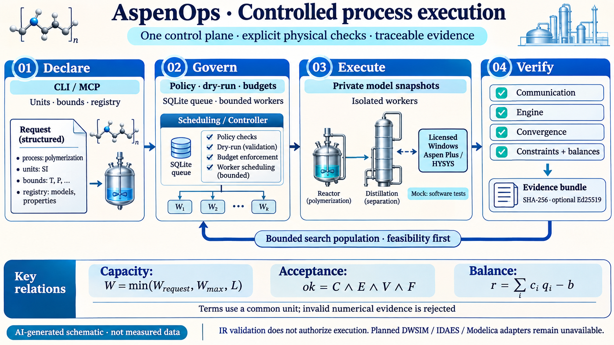
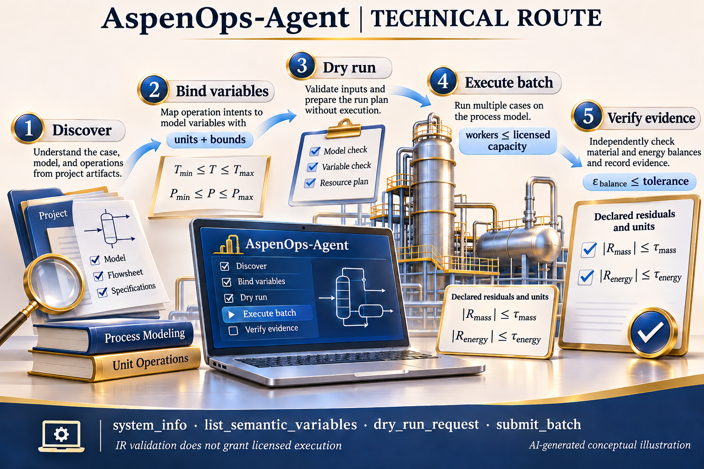
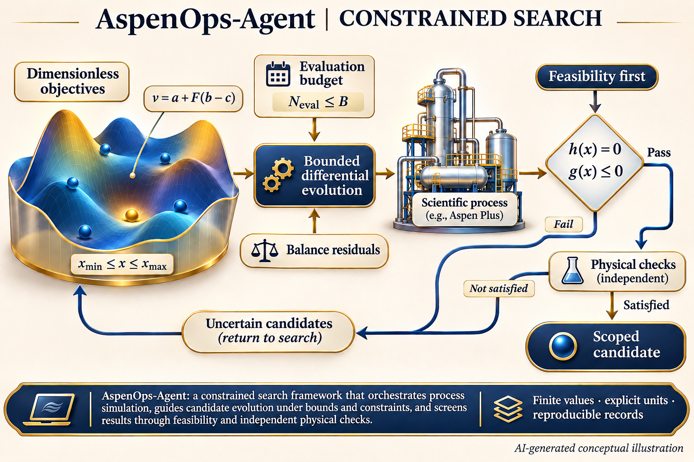
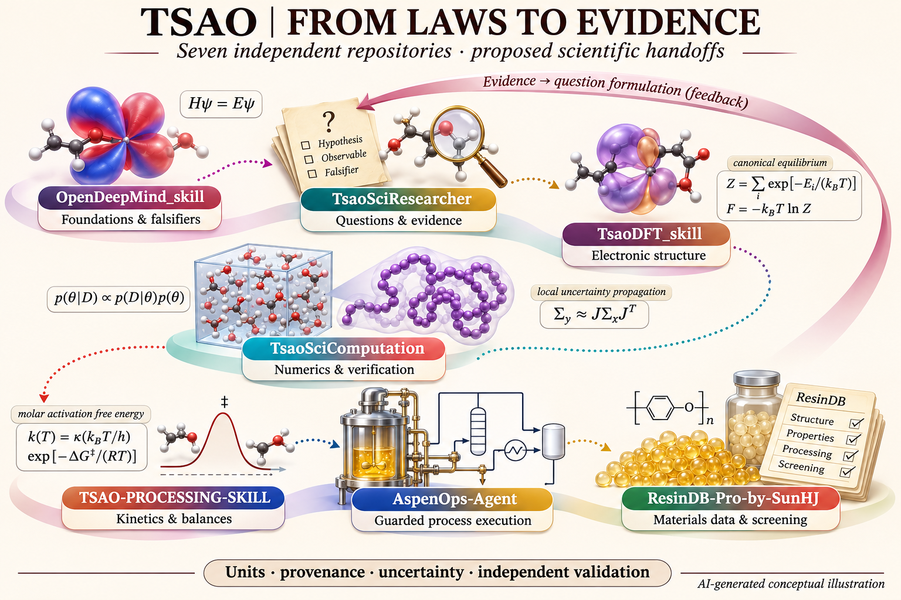

# AspenOps 2.0

**Turn process proposals into bounded, unit-aware solver requests, then check convergence, constraints and balances for every point.**

[中文](README.md) · [Quick start](#quick-start) · [Technical route](#concise-technical-route) · [Mathematical contracts](#mathematical-and-engineering-contracts) · [Acceptance](#delivery-acceptance) · [Implementation guide](docs/implementation-guide.en.md)


`aspenops-nexus 2.0.0` is a Python control plane for Aspen Plus / Aspen HYSYS. It supports condition scans on existing models, constrained optimization, reproducible failure diagnosis and agent tool calls. CLI, MCP and the durable queue share one runtime, scheduler and PoolManager. External commercial simulators and reviewed user models supply properties, equipment equations and flowsheet solutions.

Start with Mock on Linux or Windows to check request, queue, numerical and evidence contracts. Real COM execution requires a licensed Windows environment; engineering qualification remains **`PENDING_REAL_ASPEN_CERTIFICATION`**. Mock regressions do not qualify real Aspen, and discovering a ProgID does not qualify a commercial software version.

## Execution architecture



**Figure 1 — Complete AI-generated schematic.** The image explains relationships from intent to raw evidence. Equipment, arrows and formulas do not indicate that physical simulation has occurred. Each worker uses a private model snapshot; all interfaces reuse the same execution topology.

| Software responsibility | Implementation | Establish before use |
|---|---|---|
| Bind semantic variables, units and permissions | [registry](src/aspenops_nexus/registry.py), [evaluation_plan](src/aspenops_nexus/evaluation_plan.py) | Verified model nodes; never guess tree paths or object chains |
| Govern requests, isolate solves and recover queued jobs | [policy](src/aspenops_nexus/policy.py), [pool](src/aspenops_nexus/pool.py), [scheduler](src/aspenops_nexus/scheduler.py) | Allowed paths, declared license capacity and private model identity |
| Sample, search and evaluate each point | [design](src/aspenops_nexus/design.py), [optimizer](src/aspenops_nexus/optimizer.py), [evaluation](src/aspenops_nexus/evaluation.py) | Input ranges, objective scales, required outputs and engineering tolerances |
| Bind result identity and verify evidence | [provenance](src/aspenops_nexus/provenance.py), [archive_safety](src/aspenops_nexus/archive_safety.py) | Complete raw results and externally trusted signing keys |

Process proposals first become `aspenops.flowsheet/v1` IR; valid IR establishes its declared contracts only. Execution adapters for DWSIM, IDAES and Modelica/FMI, and a generic IR compiler, remain **`planned`**: no adapter in that planned set is available merely because a planning object exists. Existing v2 native-build protocols require adapter qualification and conformance evidence. [IR boundaries](docs/process-intent-ir.md) · [Native adapter gate](docs/native-adapter-conformance.md)

## Quick start

Run from the repository root. Use **uv 0.11.16**, matching CI, and preferably Python 3.12.

```bash
git clone https://github.com/SUNHAOJUN22/AspenOps-Agent.git
cd AspenOps-Agent
uv lock --check
uv sync --frozen --extra dev --extra agent --extra signing
uv run aspenops --version
uv run aspenops doctor --probe
uv run aspenops demo
uv run aspenops dry-run examples/guarded-mock-batch.example.json
uv run aspenops run-batch examples/guarded-mock-batch.example.json \
  --output var/guarded-results.json --bundle var/guarded-run-bundle.zip
uv run aspenops verify-bundle var/guarded-run-bundle.zip
```

[This request](examples/guarded-mock-batch.example.json) evaluates three temperature/reflux points and declares required outputs, a purity constraint and a feed readback check. `declared_feed_setpoint` checks consistency with `120 kg/h`; Mock does not expose every outlet, so this does not establish plant mass conservation. [Executable example regression](tests/test_readme_guarded_example.py)

`dry-run` does not start Aspen. It returns paths, registry digest, effective worker count and the I/O budget. `run-batch` saves per-point JSON and an evidence ZIP; any `ok=false` point produces exit code `2` while preserving diagnostics. `verify-bundle` checks archive safety and digests; an unsigned bundle provides integrity evidence only. [CLI contract](src/aspenops_nexus/cli.py)

On Windows, add `--extra windows` when syncing dependencies, then follow the [Windows deployment guide](docs/windows-setup.md) for real backends. `.env.example` is a template: import its variables into the actual process environment.

## Concise technical route



**Figure 2 — Complete AI-generated schematic.** The equations describe software acceptance and resource limits. Agents must follow this sequence:

1. Call `system_info` and record the backend and ProgID.
2. Call `list_semantic_variables` for the actual case / registry; verify inputs, outputs, units, bounds and permissions.
3. Call `dry_run_request` before every new batch definition, declaring required outputs, domain constraints and complete balance terms where observable.
4. Use `submit_batch` for more than 16 points or a long solve; track it with `job_status` / `job_result`. `run_batch_sync` accepts at most 16 points.
5. Accept only per-point `ok=true`; inspect communication, engine, convergence, numerical validity, constraints and balances independently. A `completed` job is insufficient.
6. Preserve raw results and call `verify_evidence_bundle` before reporting conclusions. Engineering interpretation and licensed qualification require separate review.

$$
W_{\rm eff}=\min(W_{\rm request},W_{\max},L_{\rm declared}),\qquad
\mathrm{ok}=C_{\rm comm}\land C_{\rm engine}\land C_{\rm conv}\land C_{\rm finite}\land C_{\rm constraint}\land C_{\rm balance}.
$$

$W$ and $L$ are nonnegative capacity counts; $L_{\rm declared}$ comes from administrator configuration, not automatic license measurement. Each $C$ is a Boolean acceptance gate; numerical validity includes JSON-safe diagnostics. Only declared constraints and balances are checked, so passing these gates cannot establish omitted physical conditions. [Capacity implementation](src/aspenops_nexus/pool.py) · [Point acceptance](src/aspenops_nexus/evaluation.py)

## Mathematical and engineering contracts



**Figure 3 — Complete AI-generated schematic.** The optimizer proposes candidates for validation; finishing a search does not grant engineering feasibility. The implementation formulas below define the precise quantities, units and error semantics used to interpret the image.

### Numerical admission and units

Requests reject duplicate JSON keys, nonfinite numbers and nonzero decimals that underflow to zero during parsing. The optimizer additionally rejects booleans, numeric strings, overflow and nonzero Decimal/Fraction underflow. A floating-point value already rounded to zero by its caller cannot reveal its original value. [Request parser](src/aspenops_nexus/json_input.py) · [Optimizer boundary regressions](tests/test_optimizer_numeric_inputs.py)

$$
y=\frac{a_sx+b_s-b_t}{a_t}.
$$

$x,y$ are values in source and target units; $a$ gives the scale and $b$ the offset to a shared base unit. Conversion applies only to supported compatible dimensions. An absolute $20\,{}^\circ\mathrm C$ becomes $293.15\,\mathrm K$; a $10\,{}^\circ\mathrm C$ temperature difference is $10\,\mathrm K$. Objective scales must not acquire an absolute-temperature offset. [units.py](src/aspenops_nexus/units.py)

### Balance residuals and tolerances

Readback quantities $q_i$ are converted to a shared `base_unit`; $c_i$ are finite dimensionless coefficients, $b$ is the declared target and $f$ is the scale floor:

$$
r=\operatorname{fsum}(c_1q_1,\ldots,c_nq_n,-b),\quad
S=\max\left(\sum_i|c_iq_i|,f\right),\quad \rho=|r|/S,
$$

$$
\mathrm{passed}=\mathrm{valid}\land\left(|r|\le a_{\rm tol}\ \lor\ \rho\le r_{\rm tol}\right).
$$

$r,S,f,a_{\rm tol}$ share one unit; $\rho,r_{\rm tol}$ are dimensionless. $S$ must be positive and excludes $|b|$. `valid` checks finiteness, domains and underflow before tolerances: nonzero product underflow fails, while nonzero ratio underflow uses a conservative positive upper bound tagged `relative_upper_bound`. `constraint_non_finite` / `balance_non_finite` indicate invalid evidence; `constraint_failed` / `balance_failed` indicate failed declared checks. Other scalar constraints retain their own operators and tolerances. [evaluation.py](src/aspenops_nexus/evaluation.py)

### Dimensionless objectives and a finite search budget

$$
z_j=\sigma_j\frac{y_j-r_j}{s_j},\quad J=\sum_jw_jz_j,\quad s_j>0,\ w_j>0.
$$

$y_j,r_j,s_j$ are the objective value, reference and positive scale in compatible units. $\sigma_j=+1$ minimizes and $-1$ maximizes; $z_j,J,w_j$ are dimensionless. Feasible candidates outrank infeasible ones. Feasible candidates compare objectives; infeasible candidates compare a diagnostic violation score, which is not a physical engineering loss in a common unit.

DE/rand/1/bin uses $v_d=a_d+F_m(b_d-c_d)$ within declared bounds. $a_d,b_d,c_d$ share the units of $x_d\in[\ell_d,h_d]$; $F_m$ is dimensionless. In normal, uncancelled execution, population $P\ge4$, budget $B\ge P$ and requested generations $G\ge0$ give

$$
G_*=\min\left(G,\left\lfloor\frac{B-P}{P}\right\rfloor\right),\qquad
N_{\rm eval}=P(1+G_*)\le B.
$$

A remaining budget smaller than a complete generation does not start that generation. $P,B,G,N_{\rm eval}$ are integer counts. Caching can reduce actual solves, so candidate evaluations are not real-engine run counts. The algorithm does not guarantee a global optimum; its population is not a thermodynamic ensemble. [optimizer.py](src/aspenops_nexus/optimizer.py) · [Optimization guide](docs/optimization-engine.md)

## Statistical-mechanics context and the seven-repository route



**Figure 4 — Complete AI-generated schematic.** The seven repositories remain independent. Dashed connections are proposed interfaces, not an implemented end-to-end runtime. Statistical-mechanics, rate and uncertainty formulas in the image provide scientific context; AspenOps has no partition-function, rate-constant or covariance-propagation solver.

For a canonical equilibrium system at fixed $N,V,T$ with $T>0$, microstate energies $E_i$ define

$$
\beta=(k_BT)^{-1},\quad Z=\sum_i e^{-\beta E_i},\quad
p_i=Z^{-1}e^{-\beta E_i},\quad
F=-k_BT\ln Z=U-TS,\quad S=-k_B\sum_i p_i\ln p_i.
$$

$k_B$ is Boltzmann's constant; $E_i,U,F$ are in joules, $T$ in kelvin and $S$ in joules per kelvin. $p_i,Z$ are dimensionless and $U=\sum_i p_iE_i$. These are microscopic-system energies, not molar energies; a molar expression uses $R$. Entropy is a physical statistical quantity, not agent confidence or a candidate-search score. [Tong: canonical ensemble and free energy](https://www.damtp.cam.ac.uk/user/tong/statphys/statmechhtml/S1.html)

An open reacting unit has the general species-accumulation relation

$$
\frac{dn_i}{dt}=\dot n_{i,\rm in}-\dot n_{i,\rm out}+V\sum_a\nu_{ia}r_a.
$$

$n_i$ is species amount in moles, $\dot n_i$ is mol/s, $V$ is m³, $r_a$ is the uniform or volume-averaged reaction rate in mol/(m³·s), and $\nu_{ia}$ is a dimensionless stoichiometric coefficient. Steady state sets the left side to zero; total molar flow need not be conserved in a reacting system. This is model-review context. The software checks only declared observable linear terms; actual mass and energy conservation require complete stream and transfer terms.

See [exact prompts and byte provenance](docs/assets/ai-generated/README.md) for all four images. Twenty-three earlier engineering SVGs remain in the [historical gallery](docs/assets/README.md); the [earlier English hero](docs/assets/readme-vnext/hero.en.svg) is an ordinary historical link. Every current explanatory figure uses the native AI PNGs above.

## Operational workflows and configuration

### Configuration and path safety

| Setting | Default | Operational meaning |
|---|---|---|
| `ASPENOPS_BACKEND` / `ASPENOPS_MODE` | `mock` / `default` | Real backends are `aspen_plus`, `hysys`; `readonly` forbids writes |
| `ASPENOPS_ALLOWED_ROOTS` / `ASPENOPS_STATE_DIR` | empty / `var` | Real backends require absolute allowed roots and an absolute state directory within them |
| `ASPENOPS_LICENSE_SLOTS` / `ASPENOPS_MAX_WORKERS` | `1` / license slots | Administrator-declared concurrency; verify actual entitlement and capacity separately |
| `ASPENOPS_TIMEOUT_S` / `ASPENOPS_STARTUP_TIMEOUT_S` | `1200` / `90` seconds | Per-point response and worker-start budgets |
| `ASPENOPS_WORKER_MAX_POINTS` / `ASPENOPS_WORKER_MAX_AGE_S` | `200` / `14400` seconds | Periodic recycling thresholds |
| Request / batch / semantic-operation / optimization limits | `10000000` bytes / `10000` points / `1000000` operations / `10000` evaluations | `MAX_REQUEST_BYTES`, `MAX_BATCH_POINTS`, `MAX_SEMANTIC_OPERATIONS`, `MAX_OPTIMIZATION_EVALUATIONS`, each prefixed with `ASPENOPS_` |

[Settings](src/aspenops_nexus/config.py) defines complete types and limits. Paths are expanded and canonicalized before allowed-root checks. Master models produce private snapshots and must not be overwritten. Submission pins absolute model, registry and checkpoint paths, recording `paths_pinned` and `submission_cwd`; digests still enforce content identity. Side-channel `win32com`, arbitrary Shell/VBA, unregistered paths and a second scheduler/PoolManager are prohibited. [Durable path contract](src/aspenops_nexus/durable_request.py)

### Queue, MCP and optimization

Keep the scheduler running in terminal A; submit once from terminal B using the same `ASPENOPS_STATE_DIR`:

```bash
# Terminal A; stop with Ctrl+C
uv run aspenops scheduler
```

```bash
# Terminal B; Bash
JOB_ID=$(uv run aspenops submit examples/guarded-mock-batch.example.json \
  | python -c "import json,sys; print(json.load(sys.stdin)['job_id'])")
uv run aspenops job "$JOB_ID"
# Only if cancellation is intended
uv run aspenops cancel "$JOB_ID" --grace-s 2
```

In PowerShell, use `ConvertFrom-Json` and read `.job_id`. Leases, heartbeats and fencing protect job ownership. Recoverable failures enter `retry_wait`; exhausted attempts enter `dead_letter`. Submission alone does not mean that a scheduler is executing the job. [Agent usage](docs/agent-usage.md)

```bash
uv run aspenops mcp
uv run aspenops optimize examples/optimization-request.example.json \
  --output var/optimization-result.json
```

MCP uses local stdio with the `agent` extra and `mcp>=1.30.0,<2`; its lifespan manages the same scheduler/PoolManager. Optimization tools are `submit_optimization`, `optimization_status`, `optimization_result` and `cancel_optimization`. Results retain trace, candidates, the feasible Pareto set and budget. Checkpoints are atomic review snapshots, not a promise of automatic DE-state restoration from arbitrary points. [MCP implementation](src/aspenops_nexus/mcp_server.py)

The [historical MCP lifecycle diagram](docs/assets/readme/mcp-runtime-lifecycle.svg) remains available for implementation traceability; the current AI schematics appear above.

### Process Intent checks

```bash
uv run python scripts/validate_process_ir.py examples/process-intent.example.json \
  --canonical-output var/ci/process-intent-canonical.json \
  --report-output var/ci/process-intent-report.json
uv run python scripts/render_process_ir_dashboard.py \
  --input var/ci/process-intent-report.json \
  --output-html var/ci/process-ir-dashboard.html \
  --output-svg var/ci/process-ir-dashboard.svg
uv run python scripts/validate_process_design_v2.py \
  examples/process-requirement-v1.example.json examples/process-design-v2.example.json \
  --report-output var/ci/process-design-report.json
```

v1 checks components, equipment, ports, streams, references and resource limits; canonical ordering fixes graph identity. v2 adds requirement binding, parameters, composition, charge, mass and recycle contracts. `process-ir-dashboard.html` shows contract checks, not external simulation results. Native builds require manifest, schema, unit, transaction, failure-isolation, topology-readback, signed qualification and revocation checks; missing evidence blocks execution. [Governed builder](src/aspenops_nexus/native_builder.py)

### Cache and live state

Independent `reinitialize` points support persistent caching, `same_batch_dedup` and `inflight_singleflight`. SQLite WAL and an in-memory LRU reduce repeated reads; deep copies isolate caller changes. Failure caching is off by default. `ASPENOPS_CACHE_FAILURES` still excludes communication/engine failures and tainted workers. Canonical JSON uses `allow_nan=False`. [Cache implementation](src/aspenops_nexus/cache.py)

**A cache hit is an independent historical result**; it does not write state into the current worker. `warm_start` disables caching and requires one worker, the same session and strictly increasing unique steps; it cannot mix with cold points. Binding persists across calls and leases. Dispatched steps consume their number even without convergence; cancellation before dispatch does not. `warm_start_session_mismatch` and `warm_start_step_not_increasing` reject before reads/writes while preserving the original trajectory. Session labels are not user authentication.

Shutdown, replacement, timeout or failed cold initialization invalidate continuation. After `warm_start_state_lost`, only an **actual** `reinitialize` in the current worker with communication success, engine success and convergence clears the old binding. A cached cold result cannot restore live state; constraint acceptance remains separate. [Warm-start contracts](tests/test_warm_start_session_binding.py)

## Native failure isolation

Worker IPC binds protocol version, request ID and result schema. Real backends require Windows Job Object supervision. Termination checks PID, creation time, executable fingerprint and descendant ownership; it must not terminate independently launched user Aspen processes. New handles become cleanup-owned before identity validation, and interrupted startup/replacement cleans acquired workers. [Startup ownership regressions](tests/test_pool_startup_ownership.py) · [Process supervision](src/aspenops_nexus/windows_job.py)

`timeout_s` budgets one worker response, not queueing, startup, rebuilding and evidence packaging combined. A timeout returns `worker_timeout` and recycles its worker. Point/age thresholds, crashes, protocol mismatch and taint have independent recycling paths. Replacement increments generation without restoring old live state. [Worker implementation](src/aspenops_nexus/worker.py)

## Improvement priorities and practical limits

Establish credible results before increasing throughput. These actions connect existing controls to evidence that still needs to be collected:

| Priority | Action | Evidence required |
|---|---|---|
| 1. Model and physical boundaries | Complete the real registry, Golden Cases, mass/energy terms and engineering tolerances | Licensed Windows runs, raw point results and engineer acceptance |
| 2. Effective search domain | Establish a feasible region with a few cold points; fix references and unit scales before expanding LHS/DE | Feasible fraction, failure classes, budget and candidate trace |
| 3. Avoid repeated work | Cache/deduplicate independent cold points; omit unused outputs and registry reads | Identity consistency, operation counts and numerical equivalence |
| 4. Evidence-based concurrency | Start with one worker and scale against actual licenses, memory and stability | Same-environment measurements and complete failures; Mock timings are not Aspen speedups |
| 5. Additional solvers | Implement and execute conformance contracts for each planned adapter | Manifest, units, transactions, failure isolation and target-version witnesses |

```bash
uv run aspenops benchmark --points 4 --workers 1,2
uv run python scripts/measure_cli_startup.py --output var/ci/cli-startup.json
uv run python scripts/measure_operation_counts.py --output var/ci/operation-counts.json
uv run python scripts/measure_job_store_queries.py --output var/ci/job-store-query-plan.json
```

Interpret `cli-startup.json`, `operation-counts.json` and `job-store-query-plan.json` alongside repeated same-environment, same-workload measurements. [Performance Audit V2](docs/performance-audit-2026-07-27-v2.md) is a historical comparator; new improvement claims require new measurements. This code does not grant plant safety, property-model applicability or industrial certification.

## Delivery acceptance

`main` is the only long-lived branch. The [quality report](docs/quality-report.md) describes an **archived validated baseline**, **not an automatic claim** about later commits. Current delivery evidence must bind the target SHA, complete logs, JUnit, coverage, build and artifact digests. Collected/skipped counts, old screenshots and repeated order runs cannot be added into a unique passing-test count.

```bash
uv lock --check
uv sync --frozen --extra dev --extra agent --extra signing
uv run ruff check .
uv run ruff format --check .
uv run mypy src
uv run python -m compileall -q src scripts
uv run python scripts/audit_source_tree.py
uv run pytest -W error::ResourceWarning \
  --cov=aspenops_nexus --cov-branch --cov-fail-under=95.0
uv build
uv run python scripts/check_mcp.py
uv run python scripts/check_wheel_metadata.py --dist-dir dist
uv run python scripts/validate_process_ir.py examples/process-intent.example.json
uv run aspenops --version
uv run aspenops demo
uv run python scripts/verify_delivery.py --root . --output var/ci/delivery-acceptance.json
```

CI audits six frozen dependency combinations across Linux and Windows with Python 3.11, 3.12 and 3.13. It also runs Bandit `1.9.4` high/high and Python 3.12 reverse/fixed-random order tests. `ci.yml` uses `ubuntu-24.04`; `windows-control-plane.yml` uses `windows-2025`. `generate-performance-evidence.yml` and `licensed-aspen-certification.yml` cover their respective evidence paths; workflow files define the actual execution matrix.

Manual workflows check `refs/heads/main` before `actions/checkout`; a non-main dispatch fails explicitly with exit code 2. Candidate/baseline comparisons use `detached` worktrees. Licensed jobs run serially on protected self-hosted Windows, require `expected_head_sha == GITHUB_SHA` and record `GITHUB_RUN_ID`, `GITHUB_RUN_ATTEMPT`, `LICENSED_EVIDENCE_DIR`, `run-metadata.txt` and `job_status`. Evidence uses `RUNNER_TEMP` / `${{ runner.temp }}`; artifact names include `github.run_id` / `github.run_attempt`. Licensed upload uses `aspenops-licensed-artifact` with `if-no-files-found: error`. [Licensed control plane](docs/licensed-certification-control-plane.md)

Read software, Windows-control-plane and licensed-evidence dashboards separately. Real-engine Golden Cases, signed evidence and engineer acceptance are all required. A long stability run must record actual active time and cycle results; one regression run does not prove six hours completed. [Acceptance checklist](README_ACCEPTANCE.md) · [Complete delivery process](docs/delivery-acceptance.md)

The [dashboard generator](scripts/render_test_dashboard.py) reads the supplied run's JUnit and coverage artifacts to produce `test-dashboard-quality.html`, `test-dashboard-windows.html` and `test-dashboard-licensed.html` for their respective jobs. Each dashboard summarizes only the supplied evidence and preserves missing, skipped or failed checks.

## Deterministic delivery bundle

Run bundles bind request, results, model/registry and environment digests. Readers reject unsafe paths, duplicate declarations, oversized members and digest mismatches. SHA-256 establishes the identity of declared bytes; Ed25519 requires an externally trusted public key. An embedded key cannot appoint itself as a trust root. [Evidence implementation](src/aspenops_nexus/provenance.py)

`scripts/build_delivery_bundle.py` requires a clean Git tree and the actual current SHA. It emits `aspenops-source-<sha12>.zip`, `aspenops-handover-<sha12>.zip`, `aspenops-sbom-<sha12>.spdx.json` (`SPDX-2.3`) and `SHA256SUMS`, using sorted members and canonical timestamps:

```bash
# Run on committed, verified, clean main
uv run python scripts/build_delivery_bundle.py \
  --root . --output-dir var/delivery --source-sha "$(git rev-parse HEAD)"
uv run python scripts/verify_delivery.py \
  --root . --require-current-qualification \
  --output var/ci/delivery-acceptance-current.json
```

`--require-current-qualification` needs qualifying evidence for the current source. Building a ZIP alone grants no PASS. Integrity, source authenticity and engineering applicability are separate judgments. [Bundle format](docs/delivery-bundle.md)

## Development and troubleshooting

Runtime implementation lives in `src/aspenops_nexus/`, requests in `examples/`, behavior regressions in `tests/`, and audits/packaging/measurements in `scripts/`. [CONTRIBUTING](CONTRIBUTING.md) defines the complete development gates.

| Symptom | First checks |
|---|---|
| Preflight rejection | Allowed paths, registry permissions, units, bounds, budgets and required outputs |
| `worker_timeout` | Response budget, solver state and recycling evidence; termination is not convergence |
| Warm-start rejection | Active session, last dispatched step and actual cold initialization of the current worker |
| `balance_underflow` or nonfinite evidence | Raw numbers, scale, missing terms and derived overflow; never turn a nonzero value into zero |
| Persistent pending job | Running scheduler and shared state directory |
| Evidence/license failure | Target SHA, trust root, validity period, revocation state and original blocking logs |

[Apache-2.0](LICENSE) covers this repository's code. Aspen Plus, Aspen HYSYS, Windows, customer models and commercial process data retain their own licensing and usage requirements.

<!-- CURRENT_MAIN_ACCEPTANCE_V2:START -->
## Regenerable implementation index

This index is generated by `scripts/refresh_current_main_readme.py --write` and checked for a fixed point with `--check`. The mathematical definitions and executable workflows above are the primary usage guide; the source files and earlier concept diagram below remain traceable references.

[`src/aspenops_nexus/process_ir.py`](src/aspenops_nexus/process_ir.py) · [`src/aspenops_nexus/models.py`](src/aspenops_nexus/models.py) · [`src/aspenops_nexus/pool.py`](src/aspenops_nexus/pool.py)

[Earlier English code-contract diagram](docs/current-main/aspenops-current-main-en.svg)

Software gates are not licensed Aspen Plus/HYSYS engineering certification; the external state remains PENDING_REAL_ASPEN_CERTIFICATION.

<!-- CURRENT_MAIN_ACCEPTANCE_V2:END -->
