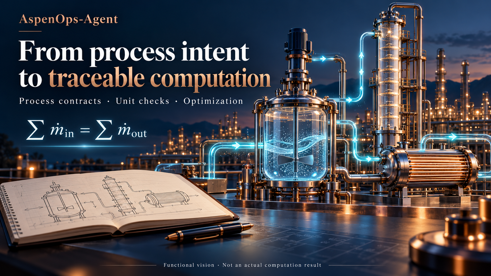
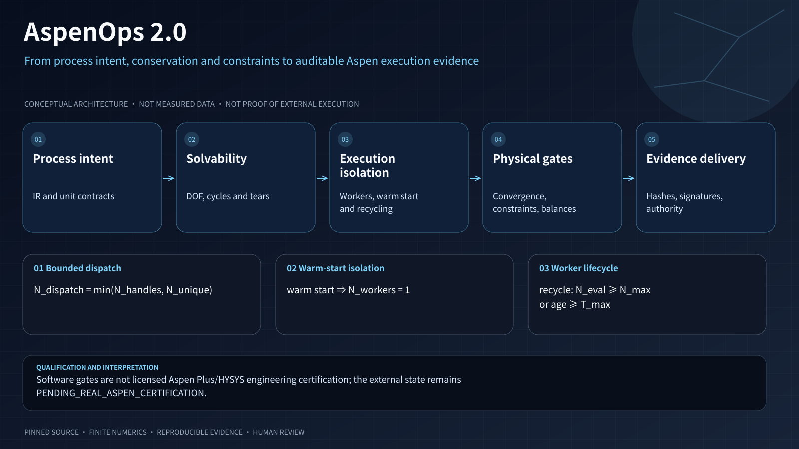

<div align="center">

# AspenOps 2.0

## Deterministic engineering control plane for Aspen Plus, Aspen HYSYS, and AI agents

**Governed requirement → typed process intent → engineering rules → verified compilation → isolated execution → engineering gates → auditable evidence → deterministic delivery**

[中文](README.md) · [Final Acceptance](README_ACCEPTANCE.md) · [Architecture](docs/architecture.md) · [Delivery Acceptance](docs/delivery-acceptance.md) · [Delivery Bundle](docs/delivery-bundle.md) · [Windows Setup](docs/windows-setup.md) · [Certification](docs/certification.md) · [Quality Report](docs/quality-report.md)


</div>

<!-- CLOSURE_STATUS_START -->
## Current code qualification and engineering boundary

- Multi-objective scalarization requires explicit units, physical dimensions, reference values and positive reference scales; changing kW/W representation cannot change the physical ranking.
- Canonical JSON/SHA-256 is implemented once by `aspenops_nexus.hashing.canonical_hash` and reused by requirements, compilation plans, topology, adapters and licensed-link evidence.
- Mock/offline qualification validates control-plane software only. Without an authorized commercial solver, licence, fixed model and signed engineering review, real execution remains `PENDING_REAL_ASPEN_CERTIFICATION`.
- README diagrams and equations document software contracts; they are not Aspen Plus/HYSYS results or plant-performance guarantees.
<!-- CLOSURE_STATUS_END -->

<!-- LOCALIZED_VISION_EN:START -->
## Project vision: from process intent to industrial evidence closure

<p align="center">
  
</p>

> The modules and equations map to current software contracts. This is a control-plane vision, not Aspen Plus/HYSYS output, plant data or engineering certification.

<!-- LOCALIZED_VISION_EN:END -->


> **Qualification boundary:** `aspenops-nexus 2.0.0` qualifies the software control plane, process intent, isolated execution, cache, scheduler, optimization, evidence chain, and deterministic delivery. Without a real commercial solver, license, fixed model, Golden Case, hardware fingerprint, engineering tolerance, and signed review, it cannot self-certify Aspen engineering performance. Status remains `PENDING_REAL_ASPEN_CERTIFICATION`.

## Acceptance status

| Item | Contract |
|---|---|
| Authoritative long-lived branch | `main` |
| Qualified platforms | Linux and Windows; real Aspen COM remains licensed-Windows only |
| Python | Python 3.11, 3.12 and 3.13 across six Linux/Windows combinations |
| Archived qualification | The archived validated baseline in `docs/quality-report.md` is historical context, not an automatic claim for later commits |
| Current regression | Check full CI, coverage and raw JUnit for the exact target commit; archived numbers are not inherited |
| Toolchain | `uv 0.11.16`; `mcp>=1.30.0,<2` |
| External qualification | `PENDING_REAL_ASPEN_CERTIFICATION` |

This is an **archived validated baseline**, not an automatic claim for arbitrary later commits. A historical PASS cannot override a failure in a changed source tree.

## AI-assisted visual system

The following twenty-three repository-owned SVGs explain implemented software contracts. They are not flowsheet output, Golden Cases, experimental data, or proof of commercial-solver execution.

| Architecture and intent | Execution and safety | Evidence and engineering |
|---|---|---|
|  |  |  |
|  |  |  |
|  |  |  |
|  |  |  |
|  |  |  |
|  |  |  |
|  |  |  |
|  |  |  |

Additional delivery, mathematics, isolation, and trajectory visuals:


## System position

```text
Human / Agent
  → ProcessRequirementDocument
  → ProcessDesignIR / aspenops.flowsheet/v2
  → engineering rules + units + DOF
  → capability profile + compilation plan
  → CasePool / scheduler / optimizer
  → isolated Windows Worker + owned COM session
  → Aspen Plus / HYSYS / Mock
  → readback + convergence + constraints + balances
  → evidence bundle + deterministic handover
```

`ProcessIntent` uses `aspenops.flowsheet/v1`, as demonstrated by `scripts/validate_process_ir.py`; `ProcessDesignIR` uses `aspenops.flowsheet/v2` and runs engineering rules through `validate_process_design`. These have separate data contracts, so submissions must use the corresponding schema.

DWSIM and IDAES remain `planned`; there is currently **no adapter** for either engine. Unknown or unavailable capabilities are reported explicitly rather than promoted from product awareness to executable support.

## Mathematical and engineering contracts

These equations describe checks actually performed by this code. Dynamic conservation equations provide the physical basis for model setup and residual definitions; AspenOps does not reimplement the Aspen thermodynamic or reaction solver. Record model versions, units, parameter sources, applicability and engineering tolerances for every use.

### 1. Units before numeric comparisons

With scale/offset pairs $(s_s,b_s)$ and $(s_t,b_t)$ relative to the canonical unit,

$$
x_t=\frac{s_s x_s+b_s-b_t}{s_t},\qquad T_K>0.
$$

`units.convert` checks supported units and finite numbers. Conversions with equal offsets compose $s_s/s_t$ first, avoiding overflow or underflow in an unnecessary canonical-unit intermediate. A nonzero proportional conversion whose final result underflows to zero raises `UnitError`. Identical units and equivalent aliases preserve representable tiny values; legitimate affine zero points such as $273.15\,\mathrm K\to0\,{}^\circ\mathrm C$ remain valid. `evaluation_plan` binds reads, writes and constraints to the registry's source unit: a request label cannot turn an unknown source into a measured temperature or pressure. Unitless text/Boolean status remains supported; dimensionless numerical quantities use explicit `1`, `fraction`, etc. Fractions are normalized before range checks: $50\%=0.5=500000\,\mathrm{ppm}$. Temperatures are checked in K; missing physical parameter units block the design. Counts cannot be relabeled as percentages.

JSON file decoding belongs to the same boundary. Let $x$ be a decimal number in the file and $\operatorname{fl}(x)$ its decoded floating-point value:

$$
\neg\operatorname{isfinite}(\operatorname{fl}(x))
\;\lor\;
\bigl(x\ne0\;\land\;\operatorname{fl}(x)=0\bigr)
\quad\Longrightarrow\quad\text{reject input}.
$$

Request, batch execution, registry, design/process IR, research document, licensed plan and evidence readers reject overflow such as `1e999` and nonzero underflow to zero such as `1e-400`. Batch files use the same duplicate-key check as other requests, so a later key cannot replace earlier scientific input. `0e-9999`, signed true zero and representable `5e-324` remain valid; JSON integers retain their integer type during decoding. A corrupt cache row containing underflow is discarded as a cache miss instead of reused as a successful result. On rejection, check the original data and unit scale and export the corrected file; do not replace a nonzero observation with zero to pass acceptance. This guarantee applies to original JSON files: the original decimal cannot be recovered from a Python float already rounded to zero by its caller. Implementation and public-entrypoint regressions: [JSON input](src/aspenops_nexus/json_input.py) · [boundary tests](tests/test_json_numeric_boundaries.py).

Implementation: [units](src/aspenops_nexus/units.py), [compiled evaluation](src/aspenops_nexus/evaluation_plan.py), [engineering rules](src/aspenops_nexus/engineering_rules.py).

### 2. Reaction element, charge and mass conservation

For elemental composition $A_{ei}$, signed stoichiometric coefficients $\nu_i$ (reactants negative), explicit ionic charge $z_i$ and declared molecular weight $M_i$,

$$
A\boldsymbol\nu=\boldsymbol0,\qquad \sum_i z_i\nu_i=0,\qquad \sum_i M_i\nu_i=0.
$$

The final equation is checked when every molecular weight is available. For each element, charge or declared mass, let $c_i=a_i\nu_i$ denote its contribution and use the relative contribution scale:

$$
R=\sum_i c_i,\qquad S=\sum_i|c_i|,\qquad
|R|\le\tau S,\qquad
\tau=\begin{cases}10^{-10}&\text{element or charge},\\10^{-6}&\text{declared mass}.\end{cases}
$$

$S=0$ means that every contribution to this quantity is zero. Products and sums use exact rational arithmetic on the accepted finite floating-point inputs, without an artificial absolute tolerance floor. Common scaling that preserves the representable stoichiometric ratios leaves the conservation decision unchanged. This preserves nonzero subnormal contributions and avoids intermediate overflow from large coefficients; the mass tolerance still permits rounding in declared molecular weights. The bounded formula grammar supports `Ca(OH)2`, `CuSO4·5H2O`, `Na+`, `Fe^3+`. Unknown composition, pseudo-components or unsupported formula syntax produce an `ENGINEERING_BLOCKER`; composition is never invented. $2H_2+O_2\to2H_2O$ conserves atoms, whereas $H_2+O_2\to H_2O$ does not, even after multiplying every coefficient of the latter by $10^{-12}$. These checks run through `validate_process_design`.

### 3. Process balances and independent validity gates

The physical balance basis is

$$
\frac{dN_i}{dt}=\sum_{\rm in}\dot n_i-\sum_{\rm out}\dot n_i+\sum_r\nu_{ir}r_rV,
\qquad \frac{dU}{dt}=\dot Q-\dot W+\sum_{\rm in}\dot n\hat h-\sum_{\rm out}\dot n\hat h.
$$

At runtime, supplied balance terms are converted to compatible units and the linear residual $R=\sum_j c_jy_j$ is compared with configured absolute/relative tolerances. Terms, signs and available observables must match the actual model; missing values are not replaced by zero.

$$
OK=C_{\rm communication}\land C_{\rm engine}\land C_{\rm convergence}
\land C_{\rm finite}\land C_{\rm constraint}\land C_{\rm balance}.
$$

`constraint_non_finite` and `balance_non_finite` differ from finite out-of-tolerance results. Evidence serialization uses `allow_nan=False`. One failed gate cannot be compensated by a high score elsewhere. Implementation: [evaluation](src/aspenops_nexus/evaluation.py).

### 4. Dimensioned optimization and feasibility ordering

Each actual output $y_j$ is converted from `result.units` to its objective unit before applying reference $r_j$ and positive scale $a_j$:

$$
\widetilde f_j(x)=\sigma_j\frac{y_j(x)-r_j}{a_j},\quad J(x)=\sum_jw_j\widetilde f_j(x),\quad w_j>0,
\qquad \sigma_j=\begin{cases}+1&\text{minimize}\\-1&\text{maximize}.\end{cases}
$$

For $r=100\,\mathrm{kW}$ and $a=50\,\mathrm{kW}$, both $125\,\mathrm{kW}$ and $125000\,\mathrm W$ yield $0.5$. Missing/incompatible units or missing/nonfinite outputs make a candidate infeasible and exclude it from the feasible Pareto set. A single objective may retain its raw scale; multiple objectives require complete dimensionless normalization. Deb ordering prefers feasible candidates, then compares their objectives; infeasible candidates are ordered by violation, without an undeclared fixed penalty coefficient.

$$
x\prec y\iff(\forall j:f_j(x)\le f_j(y))\land(\exists j:f_j(x)<f_j(y)).
$$

Equal objectives do not dominate one another. The public Pareto API rejects nonfinite values, empty objectives, negative violations and mismatched dimensions. Implementation: [optimization](src/aspenops_nexus/optimization.py), [DE/Pareto](src/aspenops_nexus/optimizer.py).

### 5. Sampling, topology, state and resource budgets

LHS draws one point from each of $n$ strata per dimension and independently permutes strata. Grid size is $N=\prod_d L_d$. Generation checks finite positive-width intervals, integer levels, $N\le100000$, $Nd\le10^6$ and $d\le256$. Nearest-neighbor ordering additionally limits input to 5000 points because its work is quadratic. Fixed seeds provide reproducibility, not model validation.

$$
x_{kd}=\ell_d+\frac{\pi_d(k)+u_{kd}}n(u_d-\ell_d),\quad u_{kd}\in[0,1),
\qquad \forall C\in\operatorname{cycles}(G),\ C\cap T\ne\varnothing.
$$

Tear edges must belong to their declared cycles. Equipment specification and degree-of-freedom checks block incomplete designs before construction. A warm-start sequence follows the stateful trajectory $x_{k+1}=F(x_k,u_k)$ and requires one serial Worker. Cold-start requests may use bounded parallelism and persistent caching, but a cache hit is an independent historical result and does not load state into the current Worker; after close, replacement or budget recycling loses state, same-trajectory warm requests fail with `warm_start_state_lost` before writes or solve, and continuation is restored only by a `reinitialize` executed on the current Worker's current engine with successful communication, engine execution, and convergence. Mock regressions do not qualify real Aspen. Implementation: [sampling](src/aspenops_nexus/design.py), [design rules](src/aspenops_nexus/engineering_rules.py), [Worker state contract](docs/architecture.md).

### 6. Evidence identity and honest test counts

$$
K=\operatorname{SHA256}(\operatorname{canonicalJSON}(\text{schema, runtime, model, registry, physical request})),
\qquad N_{\rm pass}=N_{\rm total}-N_{\rm fail}-N_{\rm error}-N_{\rm skip}.
$$

A digest proves byte identity, while a verified signature proves authenticity relative to its configured trust root; neither proves physical applicability. JUnit counts must be nonnegative integers with failure/error/skip totals no larger than the test count. Durations must be finite and nonnegative. Nested suites and testcase records must agree and are not counted twice. Malformed evidence raises an error instead of becoming a zero-failure PASS. Regression: [production-entry counterexamples](tests/test_acceptance_repair.py).

## Configuration boundaries

Permanent quality jobs use `ubuntu-24.04`; Windows control-plane and real-COM preflight use `windows-2025`. Python 3.11, 3.12 and 3.13 form six Linux and Windows software combinations.

```bash
git clone https://github.com/SUNHAOJUN22/AspenOps-Agent.git
cd AspenOps-Agent
uv lock --check
uv sync --frozen --extra dev --extra agent --extra signing
```

## Configuration and path safety

`.env.example` defaults to Mock. Real model, registry, state, and output paths remain inside allowed roots. Durable requests pin `paths_pinned` and `submission_cwd`; duplicate JSON keys, non-finite values, path escape, and unbalanced configuration fail closed.

## Native adapter conformance gate

A native adapter must pass manifest, input/output Schema, unit, failure-isolation, and deterministic-reference checks.

```bash
uv run aspenops doctor --probe
uv run python scripts/validate_process_ir.py examples/process-intent.example.json
```

`process-ir-dashboard.html` is a contract visualization, not simulation output.

## Quick start

```bash
uv run aspenops demo
uv run aspenops dry-run examples/request.example.json
uv run aspenops run-batch examples/request.example.json --output var/results.json --bundle var/run-bundle.zip
uv run aspenops verify-bundle var/run-bundle.zip
```

Before JSON parsing, `run-batch` bounds file input by `ASPENOPS_MAX_REQUEST_BYTES` (10,000,000 bytes by default) and rejects non-regular files; it then checks the normalized request size as before. In-memory Python requests remain subject to the normalized request-size gate.

## Independent validity gates

Each point records communication, engine, convergence, finite, constraint, and balance status independently. No solver success string or aggregate score can override a failed gate.

## Common workflows

```bash
uv run aspenops submit examples/request.example.json
JOB_ID=$(uv run aspenops submit examples/request.example.json | python -c "import json,sys; print(json.load(sys.stdin)['job_id'])")
uv run aspenops job "$JOB_ID"
uv run aspenops cancel "$JOB_ID" --grace-s 2
uv run aspenops scheduler
uv run aspenops optimize examples/optimization-request.example.json
```

## MCP compatibility and server lifecycle

```bash
uv run aspenops mcp
```

The MCP lifespan owns scheduler startup, shutdown, and exception cleanup. It does not expose licensed Aspen certification or bypass explicit execution authorization.

## Constrained optimization lifecycle

The optimizer preserves evaluation budgets, atomic checkpoints, Deb-style feasibility ordering, and a Pareto archive. Solver failure and non-finite objectives cannot be hidden by a favorable score.

## Scheduling and recovery

Durable states include `retry_wait` and `dead_letter`. Leases, heartbeats, cancellation deadlines, worker crashes, idempotent commits, and recovery have transaction boundaries.

## Cache, batch deduplication and singleflight

Identical immutable cold-start requests may use same-batch deduplication, persistent cache, and `inflight_singleflight`. A cache hit can be returned as an independent result, but it does not execute parameter writes or restore simulator state in the current Worker; warm-start continuation uses only that Worker's live state. Failures are not cached by default and returned objects remain deeply isolated.

## Worker ownership and recycling

Each Windows Worker owns one COM session, private model snapshot, and job scope. Point budget, age, timeout, protocol error, taint, or cancellation deadline triggers verified recycling.

## Native failure isolation

Native and commercial backends isolate process, COM apartment, temporary model, Windows Job Object, and logs. A timeout, protocol error, or crash in one Worker cannot contaminate another Worker. Recovery terminates the owned process tree, records the violation and generation, and creates a replacement instead of continuing on an unknown COM state.

## Performance engineering and evidence

```bash
uv run python scripts/measure_cli_startup.py --output var/ci/cli-startup.json
uv run python scripts/measure_operation_counts.py --output var/ci/operation-counts.json
uv run python scripts/measure_job_store_queries.py --output var/ci/job-store-query-plan.json
uv run python scripts/render_test_dashboard.py --input-dir var/ci --output-html var/ci/test-dashboard-quality.html --output-svg var/ci/test-dashboard-quality.svg
```

Governed artifacts include `cli-startup.json`, `operation-counts.json`, `job-store-query-plan.json`, `test-dashboard-quality.html`, and the Python/Windows/licensed dashboards. Interpretation rules are documented in Performance Audit V2. Current-run evidence is isolated under `RUNNER_TEMP`/`${{ runner.temp }}`; artifact names include `github.run_id` and `github.run_attempt`.

## Industrial use cases

The software supports batch parameter scans, constrained optimization, grade transitions, failure replay, and governed digital-twin handoff. It does not replace process engineering, HAZOP/LOPA/SIL, customer-model approval, or plant authorization.

## Delivery acceptance

`scripts/verify_delivery.py` validates version, README, workflows, AI visuals, archived qualification, and the real-Aspen boundary. A software PASS means the delivery tree satisfies its declared contract; external status remains `PENDING_REAL_ASPEN_CERTIFICATION`.

```bash
uv run python scripts/verify_delivery.py --root . --output var/ci/delivery-acceptance.json
```

## Deterministic delivery bundle

`scripts/build_delivery_bundle.py` creates the following from a clean Git tree:

```text
aspenops-source-<sha12>.zip
aspenops-handover-<sha12>.zip
aspenops-sbom-<sha12>.spdx.json
SHA256SUMS
```

The SBOM uses `SPDX-2.3`. Members are sorted, timestamps normalized, and every artifact receives SHA-256. `<sha12>` denotes the first 12 commit characters; it is not a runtime command placeholder.

```bash
uv run python scripts/build_delivery_bundle.py --root . --output-dir var/delivery --source-sha 0123456789abcdef0123456789abcdef01234567
```

## Evidence bundle integrity and authenticity

Permanent workflows are `ci.yml`, `windows-control-plane.yml`, `generate-performance-evidence.yml`, and `licensed-aspen-certification.yml`. Manual evidence accepts only `refs/heads/main`; the dispatch guard runs before `actions/checkout` and **fails explicitly with exit code 2** rather than producing an all-skipped false green. Candidate and baseline revisions are validated in `detached` worktrees.

The licensed environment requires `expected_head_sha == GITHUB_SHA` and records `GITHUB_RUN_ID`, `GITHUB_RUN_ATTEMPT`, `LICENSED_EVIDENCE_DIR`, `run-metadata.txt`, `job_status`, and `aspenops-licensed-artifact`. Uploads use `if-no-files-found: error`, live under `runner.temp`, and real Aspen tasks remain serial.

## Repository structure

- `src/aspenops_nexus/`: control plane, Process IR, scheduler, cache, optimizer, evidence, and adapters;
- `tests/`: numerical, concurrency, file-safety, documentation, artifact, and workflow contracts;
- `scripts/`: audits, performance probes, dashboards, Process IR, and delivery bundles;
- `.github/workflows/`: four permanent workflows;
- `docs/assets/readme/`: twenty-three deterministic SVGs.

## Troubleshooting

Run `uv run aspenops doctor --probe`, then inspect allowed roots, registry SHA, model identity, license, worker generation, state database, and evidence bundle. Never disable tests, relax tolerances, or reinterpret non-convergence as success.

## Final acceptance commands

```bash
python scripts/final_acceptance_preflight.py --root . --json
uv lock --check
uv sync --frozen --extra dev --extra agent --extra signing
uv run ruff check .
uv run ruff format --check .
uv run mypy src
uv run python -m compileall -q src scripts
uv run python scripts/audit_source_tree.py
uv run pytest -W error::ResourceWarning --cov=aspenops_nexus --cov-branch --cov-fail-under=95.0
uv build
```

## License

Apache-2.0 covers this repository only. Aspen Plus, Aspen HYSYS, Windows, license services, customer models, and process data remain subject to their own licenses, confidentiality, and safety controls.


### Exact current-tree acceptance

Final delivery binds tests, coverage, and Git identity to the current source tree. A historical PASS never substitutes for current-tree qualification.

```bash
uv run python scripts/verify_delivery.py \
  --root . \
  --require-current-qualification \
  --output var/ci/delivery-acceptance-current.json
```

Acceptance dashboards include `test-dashboard-quality.html`, `test-dashboard-windows.html`, `test-dashboard-licensed.html`, `test-dashboard-licensed-mock.html`, and the per-Python dashboards. Each dashboard summarizes only its own job evidence and is not real-Aspen engineering certification.

<!-- CURRENT_MAIN_ACCEPTANCE_V2:START -->
## Current implementation: code, mathematics and usage



> Software gates are not licensed Aspen Plus/HYSYS engineering certification; the external state remains PENDING_REAL_ASPEN_CERTIFICATION.

#### Bounded dispatch

$$
N_{\mathrm{dispatch}}=\min(N_{\mathrm{handles}},N_{\mathrm{unique}})
$$

This is the actual CasePool dispatch bound: the smaller of available handles and deduplicated requests. Licence, memory and stability limits still require deployment checks; the formula does not claim automatic measurement of all resource limits.

Source mapping: [`src/aspenops_nexus/pool.py`](src/aspenops_nexus/pool.py)

#### Warm-start isolation

$$
\exists q:\neg q.\mathrm{reinitialize}\;\Longrightarrow\;N_{\mathrm{workers}}=1
$$

Requests that reuse solver history require a single worker; incompatible pool calls are rejected. Cold-start batches may run concurrently and use persistent cache, but a cache hit is an independent historical result and does not restore simulator state in the current Worker. After state loss, warm requests fail before writes or solve; continuation requires a reinitialize executed on the current Worker with successful communication, engine execution and convergence. Mock regressions do not qualify real Aspen.

Source mapping: [`src/aspenops_nexus/pool.py`](src/aspenops_nexus/pool.py)

#### Worker lifecycle

$$
R_{\mathrm{periodic}}=(N_{\mathrm{eval}}\ge N_{\max})\lor(t_{\mathrm{age}}\ge t_{\max})
$$

Periodic recycling is triggered by evaluation count or monotonic-clock age. Crashes, timeouts, protocol errors and tainted state have additional recycle conditions. This Boolean expression is the periodic rule, not the complete failure taxonomy or proof of Aspen convergence.

Source mapping: [`src/aspenops_nexus/pool.py`](src/aspenops_nexus/pool.py)

#### Polling and external-call boundary

$$
T_{\mathrm{timeout}},\Delta t\in\mathbb{R}_{>0}\cap\mathbb{R}_{\mathrm{finite}},\quad n_{\mathrm{stable}}\in\mathbb{N}_{>0}
$$

Before reading the external COM engine, timeout_s and poll_interval_s must be finite positive numbers and stable_samples a positive integer; booleans are not numeric configuration values. NaN cannot disable timeout, and an unrepresentable COM integer flag remains UNKNOWN instead of raising an unhandled overflow. Visible Aspen runs must first be observed running before stable idle and status nodes can qualify as convergence evidence; the startup confirmation window defaults to 30 seconds and can be adjusted with ASPENOPS_STATUS_STARTUP_TIMEOUT_S. If no running state is observed within the window, the run fails closed as a timeout even if the status tree retains old success text. Polling termination is not convergence; status nodes, negative markers and idle evidence still control classification.

Source mapping: [`src/aspenops_nexus/convergence.py`](src/aspenops_nexus/convergence.py) · [`tests/test_polling_numeric_boundaries.py`](tests/test_polling_numeric_boundaries.py)

### Usage and acceptance sequence

1. Check the installation environment, input structure, units, applicability and execution permissions.
2. Use the source mappings above to distinguish native implementation, explanatory contracts and external execution requirements.
3. Run focused regression and full quality gates before long-duration testing of pinned commits.
4. Preserve original logs, machine-readable reports and limitations; missing evidence must never be reported as PASS.

```bash
uv lock --check
uv sync --frozen --extra dev --extra agent --extra signing
uv run python scripts/verify_delivery.py
```

Retest every changed commit. Baseline regression, two three-hour regression segments, browser visual checks and external engineering qualification are distinct evidence classes. Without original receipts, no six-hour completion is claimed.

Implementation anchors: [`src/aspenops_nexus/process_ir.py`](src/aspenops_nexus/process_ir.py) · [`src/aspenops_nexus/models.py`](src/aspenops_nexus/models.py) · [`src/aspenops_nexus/pool.py`](src/aspenops_nexus/pool.py)

<!-- CURRENT_MAIN_ACCEPTANCE_V2:END -->
