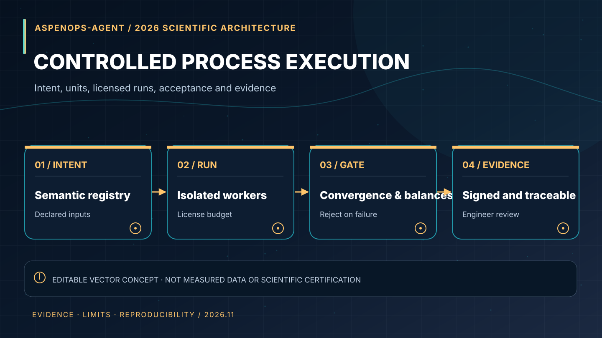

# AspenOps 2.0

**Turn an AI process proposal into a bounded execution request, then use units, constraints, balances and evidence to decide whether each calculated point is acceptable.**

[简体中文](README.md) · [Architecture](docs/architecture.md) · [Windows setup](docs/windows-setup.md) · [Agent usage](docs/agent-usage.md) · [Delivery acceptance](docs/delivery-acceptance.md)


This AI concept design follows the implementation boundaries. Exact equations, units and states are defined below and in the linked code; the illustrated plant is not a real Aspen run, measured plant data or certification. The Chinese edition uses its own Chinese artwork. Earlier engineering diagrams remain in the [technical gallery and provenance notes](docs/assets/README.md).

## Scientific execution architecture — editable figure



This source-editable vector diagram describes the software boundary, not a validated solver run or a measured scientific result.

## System position and current capabilities

`aspenops-nexus 2.0.0` is a Python control plane for Aspen Plus / Aspen HYSYS automation. It unifies the CLI, MCP, durable queue and simulator workers to govern **how a request executes, which results are acceptable, and how they can be checked later**. Thermodynamic properties and flowsheet solutions come from the licensed external simulator and the user's model.

| Capability | Implemented behavior | Code and boundary |
|---|---|---|
| Semantic I/O | Registry keys, identifiers, access, units, bounds, read deduplication and conflicting-write checks | [registry](src/aspenops_nexus/registry.py), [evaluation_plan](src/aspenops_nexus/evaluation_plan.py); example paths require confirmation against each model |
| Batch execution | Private model snapshots, separate processes, timeouts, bounded concurrency and point verification | [batch](src/aspenops_nexus/batch.py), [worker](src/aspenops_nexus/worker.py), [pool](src/aspenops_nexus/pool.py) |
| Backends | Portable Mock; Aspen Plus COM and HYSYS Spreadsheet adapters for existing models | [factory](src/aspenops_nexus/backends/factory.py); real backends require licensed Windows and a reviewed model registry |
| Long jobs | SQLite queue, leases, heartbeat, cancellation, retries, dead letters and idempotent submission | [scheduler](src/aspenops_nexus/scheduler.py); standalone CLI submissions require a running scheduler service |
| Optimization and sampling | Bounded DE, mixed variables, feasibility ordering, Pareto, LHS and grids | [optimization](src/aspenops_nexus/optimization.py), [optimizer](src/aspenops_nexus/optimizer.py), [design](src/aspenops_nexus/design.py) |
| Process intent | v1 graph validation; v2 requirement binding, engineering rules, compilation plans and qualified native-build protocols | [IR](src/aspenops_nexus/process_ir.py), [v2 validation](src/aspenops_nexus/design_validation.py), [plans](src/aspenops_nexus/compilation_plan.py) |
| Research and evidence | Research-object/claim tracking, canonical JSON, SHA-256, optional Ed25519, archive safety and deterministic delivery | [research layer](src/aspenops_nexus/research.py), [provenance](src/aspenops_nexus/provenance.py); a valid study manifest grants no execution authority |

There is **no adapter** for DWSIM, IDAES or Modelica/FMI execution. These backends and general `aspenops.flowsheet/v1` compilers remain `planned`. Existing v2 plan objects, native-build protocols and offline tests do not replace production adapter qualification. The [capability matrix](src/aspenops_nexus/simulation_agents.py) distinguishes existing-model execution from IR compilation.

**Real engineering qualification remains `PENDING_REAL_ASPEN_CERTIFICATION`.** Mock regressions do not qualify real Aspen. Real acceptance requires the target Windows host, commercial licenses, fixed model/registry, Golden Cases, engineering tolerances, signed evidence and engineer approval. Discovering a ProgID also does not certify that commercial software version.

## Quick start

Run from the repository root. Use **uv 0.11.16** and Python 3.12 to match the primary CI environment; the project supports Python 3.11, 3.12 and 3.13.

```bash
git clone https://github.com/SUNHAOJUN22/AspenOps-Agent.git
cd AspenOps-Agent
uv lock --check
uv sync --frozen --extra dev --extra agent --extra signing
uv run aspenops --version
uv run aspenops doctor --probe
uv run aspenops demo
uv run aspenops dry-run examples/guarded-mock-batch.example.json
uv run aspenops run-batch examples/guarded-mock-batch.example.json \
  --output var/guarded-results.json --bundle var/guarded-run-bundle.zip
uv run aspenops verify-bundle var/guarded-run-bundle.zip
```

This [executable request](examples/guarded-mock-batch.example.json) contains three temperature/reflux points, required outputs, a purity constraint and a linear feed-setpoint consistency check. `declared_feed_setpoint` checks that the flow readback equals `120 kg/h`; **it is not a whole-plant mass-conservation proof**, because the Mock does not expose every outlet. The original [minimal batch](examples/batch-request.example.json) remains useful for connection and execution smoke checks.

`dry-run` opens no Aspen instance and reports paths, registry digest, effective workers and I/O budget. `run-batch` writes per-point JSON and an evidence ZIP; it exits with code `2` if any point has `ok=false`, while preserving diagnostics. `verify-bundle` checks the archive and hashes; an unsigned bundle supplies integrity evidence only. [CLI implementation](src/aspenops_nexus/cli.py)

Add `--extra windows` when synchronizing dependencies on Windows. Follow the [Windows guide](docs/windows-setup.md) for real environments. `.env.example` is a template: import its settings into the actual process environment.

## Configuration boundaries

| Environment variable | Default | Meaning |
|---|---|---|
| `ASPENOPS_BACKEND` | `mock` | `mock`, `aspen_plus`, or `hysys` |
| `ASPENOPS_MODE` | `default` | `readonly` rejects parameter writes; some extended operations require `enhanced` |
| `ASPENOPS_ALLOWED_ROOTS` | Empty | Semicolon-separated roots; real backends require absolute roots |
| `ASPENOPS_STATE_DIR` | `var` | Cache/job directory; real backends require an absolute path inside an allowed root |
| `ASPENOPS_LICENSE_SLOTS` / `ASPENOPS_MAX_WORKERS` | `1` / license slots | Administrator-declared concurrency limits; code does not prove license capacity |
| `ASPENOPS_TIMEOUT_S` / `ASPENOPS_STARTUP_TIMEOUT_S` | `1200` / `90` seconds | Default point-response budget / worker-startup budget |
| `ASPENOPS_WORKER_MAX_POINTS` / `ASPENOPS_WORKER_MAX_AGE_S` | `200` / `14400` seconds | Periodic recycling limits |
| `ASPENOPS_MAX_REQUEST_BYTES` / `ASPENOPS_MAX_BATCH_POINTS` | `10000000` / `10000` | Request size / batch size limits |
| `ASPENOPS_MAX_SEMANTIC_OPERATIONS` | `1000000` | Declared semantic-operation budget per batch |
| `ASPENOPS_MAX_OPTIMIZATION_EVALUATIONS` | `10000` | Optimization evaluation cap; additional caps are 64 variables and 16 objectives |

[Settings](src/aspenops_nexus/config.py) defines the remaining scheduler options and type checks. [Resource-budget](tests/test_config_resource_budgets.py) and [batch-limit](tests/test_batch_resource_limits.py) tests cover rejection paths.

## Configuration and path safety

Paths are expanded and resolved before allowed-root checks. Real backends reject empty or relative roots and state directories outside them. The master model supplies private snapshots; workers verify model/registry digests around startup. `readonly` rejects actual write requests. [Policy](src/aspenops_nexus/policy.py) · [Snapshot identity tests](tests/test_phase0_artifact_identity.py)

Durable submission pins model, registry and checkpoint locations to absolute paths, recording `paths_pinned` and `submission_cwd`. A scheduler started in another directory still uses the submitted locations; hashes continue to protect content identity. [Durable paths](src/aspenops_nexus/durable_request.py) · [CLI regressions](tests/test_cli_durable_queue.py)

`run-batch` limits regular-file size before parsing and checks canonical request size afterward. Duplicate JSON keys and invalid numbers are not silently rewritten. Keep output paths distinct from the master model; agents must not bypass the runtime through raw `win32com`, arbitrary Shell/VBA or unregistered simulator paths.

## Mathematical and engineering contracts

These equations map to executable code. They describe calculation and acceptance; dimensional consistency, convergence and model applicability each require their own verification.

### 1. Input and units

For a JSON decimal $x$, let $\operatorname{fl}(x)$ be its parsed binary floating-point value:

$$
\neg\operatorname{finite}(\operatorname{fl}(x))\ \lor\
(x\ne0\land\operatorname{fl}(x)=0)\quad\Longrightarrow\quad\text{reject input}.
$$

`1e999` and `1e-400` are rejected; exact zeros and representable subnormals remain valid. This guarantee applies to original JSON text: a Python value already rounded to zero cannot be recovered. [Implementation](src/aspenops_nexus/json_input.py) · [Boundary tests](tests/test_json_numeric_boundaries.py)

Conversion from the registry's source unit to a target unit is:

$$
y=\frac{a_sx+b_s-b_t}{a_t}.
$$

$a_s,a_t$ are scales to a common base; $b_s,b_t$ are offsets. Proportional conversions with equal offsets compose $a_s/a_t$ first to avoid intermediate underflow; a nonzero final quantity that underflows to zero is rejected. Legitimate affine zeros such as `273.15 K = 0 C` remain valid. Unknown or incompatible units fail validation, and adding an output label cannot supply an unknown source unit. Use `1`, `fraction`, `%`, or `ppm` for dimensionless values. [Units](src/aspenops_nexus/units.py) · [Tests](tests/test_unit_intermediate_overflow.py)

### 2. Scalar constraints and open boundaries

Let $y$ be the readback in the constraint unit, $b$ the limit, and $\tau\ge0$ a tolerance in that same unit:

| Operator | Actual passing condition | Nonnegative violation distance $v$ |
|---|---|---|
| `<` | $y<b-\tau$ | $\max(0,y-(b-\tau))$ |
| `<=` | $y\le b+\tau$ | $\max(0,y-(b+\tau))$ |
| `>` | $y>b+\tau$ | $\max(0,(b+\tau)-y)$ |
| `>=` | $y\ge b-\tau$ | $\max(0,(b-\tau)-y)$ |
| `==` | $\lvert y-b\rvert\le\tau$ | $\max(0,\lvert y-b\rvert-\tau)$ |

At an open boundary the distance can be zero while `passed` is still `false`. Booleans, text, nonfinite readbacks and overflowing derived violations cannot satisfy numerical constraints. [Implementation](src/aspenops_nexus/evaluation.py) · [Boundary and optimizer-admission regressions](tests/test_evaluation.py)

### 3. Linear balances

`BalanceSpec` converts every $q_i$ into one `base_unit` and applies finite dimensionless coefficients $c_i$:

$$
r=\operatorname{fsum}(c_1q_1,\ldots,c_nq_n,-b),\qquad
S=\max\left(\operatorname{fsum}(|c_1q_1|,\ldots,|c_nq_n|),f\right),\qquad
\rho=|r|/S.
$$

$$
\text{passed}\iff\text{all terms and derived quantities are valid}\land
\left(|r|\le a_{\rm tol}\ \lor\ \rho\le r_{\rm tol}\right).
$$

$b$ is `expected`; $r,b,S,f,a_{\rm tol}$ use `base_unit`, while $\rho,r_{\rm tol}$ are dimensionless. `floor=f` defaults to $10^{-12}$ and should be chosen as a positive scale for the operating range. If the user sets $f=0$ and every term is zero, the zero denominator makes the balance invalid. Mass flow and power cannot be added. Real energy balances require complete, consistently dimensioned power/enthalpy-flow terms; missing terms cannot be replaced by zeros.

This revision includes $-b$ in the same compensated sum, repairing the false zero from rounding `fsum(1e16, 1) - 1e16` in two stages. A nonzero product that underflows triggers `balance_underflow`. A nonzero ratio that underflows uses the smallest positive float as a conservative upper bound, with `relative_upper_bound=true`. Balance requests use the `compensated-residual-v2` cache semantics so previous acceptance decisions are not replayed. This handles finite float inputs; it cannot recover precision already lost in measurements or a model.

[Definitions](src/aspenops_nexus/models.py) · [Dimension compilation](src/aspenops_nexus/evaluation_plan.py) · [Evaluation](src/aspenops_nexus/evaluation.py) · [Target-cancellation tests](tests/test_balance_residual_cancellation.py) · [Underflow tests](tests/test_balance_underflow.py) · [Dimension tests](tests/test_balance_dimension_contract_v19.py)

### 4. Point acceptance

$$
\mathrm{ok}=C\land E\land V\land F.
$$

$C$ is `communication_ok`; $E$ is `engine_ok`; $V$ requires a true convergence flag and `convergence_state="converged"`; $F$ requires valid outputs, JSON-safe diagnostics and passing declared constraints/balances. Required numerical outputs must be finite; invalid optional outputs become `null` with diagnostics. `ok=true` covers the checks actually declared by the request. It does not invent missing product limits or a complete conservation model. [Implementation](src/aspenops_nexus/evaluation.py) · [Nonfinite evidence](tests/test_nonfinite_evidence.py) · [Result protocol](tests/test_result_protocol_contracts.py)

### 5. Reaction conservation and recycle topology

The v2 engineering validator uses negative stoichiometric coefficients $\nu_i$ for reactants and positive ones for products. $A_{ei}$ is the element count, $z_i$ charge, and $M_i$ the declared molecular weight:

$$
A\boldsymbol\nu=0,\qquad \sum_i z_i\nu_i=0,\qquad \sum_i M_i\nu_i=0.
$$

The last check applies only when every molecular weight is available. For one conserved contribution $a_i\nu_i$, products and sums use exact rational representations of the accepted float inputs:

$$
|R|\le\tau S,\quad R=\sum_i a_i\nu_i,\quad S=\sum_i|a_i\nu_i|,\qquad
\tau=\begin{cases}10^{-10}&\text{elements, charge},\\10^{-6}&\text{declared mass}.\end{cases}
$$

There is no absolute tolerance floor that could conceal small stoichiometric coefficients. Unknown composition or unsupported formula syntax produces `ENGINEERING_BLOCKER`. The material-flow graph $G$ must have its cycles cut by the set $T_{\rm owned}$ of tear edges owned by valid recycle contracts:

$$
G\setminus T_{\rm owned}\ \text{is a directed acyclic graph}.
$$

This is a **v2 engineering rule**. v1 IR emits warnings for cycles by default; `--disallow-recycles` makes them errors. [Engineering rules](src/aspenops_nexus/engineering_rules.py) · [v2 tests](tests/test_process_ir_v2_rules.py) · [Numerical counterexamples](tests/test_acceptance_repair.py)

### 6. Design of experiments

LHS samples each of $n$ strata in each dimension and independently permutes them. $\ell_d,h_d$ are bounds, $\pi_d$ a permutation, and $u_{kd}\in[0,1)$:

$$
x_{kd}=\ell_d+\frac{\pi_d(k)+u_{kd}}{n}(h_d-\ell_d),\qquad
N_{\rm grid}=\prod_d L_d.
$$

Endpoints and interval width must be finite, with $h_d>\ell_d$. Generation limits are $N\le100000$, $Nd\le10^6$, and $d\le256$; a grid requires at least two levels per dimension. Nearest-neighbor ordering has a separate 5000-point limit. A fixed seed supports reproduction, not a claim of statistical sufficiency. [Implementation](src/aspenops_nexus/design.py) · [Tests](tests/test_design.py)

### 7. Objective normalization, Pareto and optimization budget

Readbacks are converted from `result.units` into each objective's unit before normalization:

$$
z_j=\sigma_j\frac{y_j-r_j}{s_j},\quad J=\sum_jw_jz_j,\quad s_j>0,\ w_j>0,
\qquad\sigma_j=\begin{cases}+1&\text{minimize},\\-1&\text{maximize}.\end{cases}
$$

$r_j,s_j$ use the objective unit and $z_j$ is dimensionless. Multiple objectives require all of `unit`, `dimension`, `reference_value`, and `reference_scale`; a single objective may retain its raw scale. When changing kW/W representation, convert reference values and scales too. [Implementation](src/aspenops_nexus/optimization.py) · [Contract tests](tests/test_optimization_contracts.py)

Feasible candidates outrank infeasible ones. Two feasible candidates are compared by $J$; two infeasible ones by diagnostic violation. Violation is a search-ordering signal, not an engineering loss in a single physical unit. After expressing objectives as minimization:

$$
x\prec y\iff[\forall j:f_j(x)\le f_j(y)]\land[\exists j:f_j(x)<f_j(y)].
$$

DE/rand/1/bin mutates with $v_d=a_d+F_m(b_d-c_d)$, crosses over, and clips to $[\ell_d,h_d]$; at least one dimension takes the mutation branch. With population $P\ge4$, requested generations $G\ge0$, and budget $B\ge P$, normal uncancelled execution satisfies:

$$
G_* =\min\left(G,\left\lfloor\frac{B-P}{P}\right\rfloor\right),\qquad
N_{\rm eval}=P(1+G_*)\le B.
$$

This counts candidate evaluations; caching can reduce physical solves. A generation is not started unless its full population fits the remaining budget. The algorithm does not guarantee a global optimum. [DE/Pareto](src/aspenops_nexus/optimizer.py) · [Budget boundary tests](tests/test_optimizer_complete_edges.py)

### 8. Concurrency, I/O and identity

$$
W_{\rm eff}=\min(W_{\rm request},W_{\max},L),\quad
W_{\rm dispatch}=\min(N_{\rm handles},N_{\rm unique}),\quad
\Delta N_{\rm read}=N_{\rm declared}-N_{\rm unique\ read}.
$$

$L$ is the declared license-slot count. PoolManager includes workers being created in its global resident budget. A node shared by outputs, constraints and balances is read once, while each check retains its semantics. Operation budgets count declarations so deduplication cannot bypass them. [Batch](src/aspenops_nexus/batch.py) · [Pool manager](src/aspenops_nexus/pool_manager.py) · [I/O tests](tests/test_evaluation_plan.py)

$$
K=\operatorname{SHA256}\!\left(\operatorname{UTF8}\bigl(\operatorname{canonicalJSON}(I)\bigr)\right).
$$

Cache identity $I$ includes runtime schema/version, backend and stable runtime identity, model/registry digests, physical request semantics and algorithm-version tags. Canonical JSON sorts keys, fixes separators, preserves Unicode and uses `allow_nan=False`. [Hashing](src/aspenops_nexus/hashing.py) · [Cache identity](src/aspenops_nexus/pool.py) · [Single-source hashing tests](tests/test_canonical_hash_single_source.py)

## Independent validity gates

Inspect `communication_ok`, `engine_ok`, `converged`, `feasible`, `violations`, and `balance_residuals` for each point. `constraint_non_finite` / `balance_non_finite` indicate invalid numerical evidence; `constraint_failed` / `balance_failed` indicate unsuccessful declared checks. A returned process, idle engine or `completed` job does not substitute for per-point `ok`.

The Mock uses inspectable synthetic relationships:

$$
X=\frac{1}{1+\exp(-(T-80)/18)},\quad
p=\operatorname{clip}(0.78+0.018R+0.003N-0.0002F,0,0.9999),
$$

$$
Q=\max\left(0,\frac{F(0.06T+1.4R+0.08N)}{\max(P,0.1)}\right),\qquad
F_{\rm product}=FXp.
$$

$T,P,F,R,N$ are the Mock-file conventions for Celsius temperature, pressure in bar, feed in kg/h, reflux ratio and stage count. $Q$ is a synthetic kW output. These coefficients are test-fixture parameters and must not be used for equipment sizing or property prediction. [Mock source](src/aspenops_nexus/backends/mock.py)

## Common workflows

**Small batches:** run `doctor`, inspect the registry, then use `dry-run` and `run-batch`. Validate a few points' units, constraints and convergence evidence before expanding the range. Register confirmed model nodes; do not guess Aspen Tree Paths or HYSYS object chains.

**Durable batches:** start the service in terminal A and submit from terminal B with the same environment. Both processes must share `ASPENOPS_STATE_DIR`.

```bash
# Terminal A: keep running; stop with Ctrl+C
uv run aspenops scheduler
```

```bash
# Terminal B: Bash; submit exactly once
JOB_ID=$(uv run aspenops submit examples/guarded-mock-batch.example.json \
  | python -c "import json,sys; print(json.load(sys.stdin)['job_id'])")
uv run aspenops job "$JOB_ID"
# Only if cancellation is intended:
uv run aspenops cancel "$JOB_ID" --grace-s 2
```

In PowerShell, save the output of `uv run aspenops submit ... | ConvertFrom-Json` and read `.job_id`; do not copy the Bash assignment syntax. A successful submission does not mean the scheduler has executed the job. [Job guide](docs/agent-usage.md)

**Python:** save as `run_guarded.py` at the repository root and execute `uv run python run_guarded.py`. Process spawning requires the `__main__` guard.

```python
from pathlib import Path
from aspenops_nexus.batch import dry_run_document, run_batch_document
from aspenops_nexus.config import Settings
from aspenops_nexus.json_input import load_request_object


def main():
    settings = Settings.from_env()
    request = load_request_object(
        Path("examples/guarded-mock-batch.example.json"),
        max_bytes=settings.max_request_bytes,
    )
    print(dry_run_document(request, settings))
    results = run_batch_document(request, settings)
    for point in results:
        print(point["ok"], point["values"], point["violations"])
    if not all(point["ok"] for point in results):
        raise SystemExit(2)


if __name__ == "__main__":
    main()
```

## MCP compatibility and server lifecycle

```bash
uv run aspenops mcp
```

Install the `agent` extra for local stdio MCP; the dependency contract is `mcp>=1.30.0,<2`. The service lifespan starts and stops one scheduler/PoolManager. [Implementation](src/aspenops_nexus/mcp_server.py) · [Compatibility check](scripts/check_mcp.py) · [MCP lifecycle technical diagram](docs/assets/readme/mcp-runtime-lifecycle.svg)

Agent sequence: `system_info` → `list_semantic_variables` → `dry_run_request` → `submit_batch` → `job_status` / `job_result` → `verify_evidence_bundle`. `run_batch_sync` is capped at 16 points; long solves should use the background queue even with fewer points. Optimization tools are `submit_optimization`, `optimization_status`, `optimization_result`, and `cancel_optimization`. Accept only `ok=true` points and separately verify the evidence and engineering interpretation.

## Constrained optimization lifecycle

```bash
uv run aspenops optimize examples/optimization-request.example.json \
  --output var/optimization-result.json
```

The [example](examples/optimization-request.example.json) searches temperature and ordinal reflux choices with a minimum-purity constraint, explicit objective units and normalization scales. Establish the feasible domain before increasing population or generations; Settings still caps the budget. Results retain trace, candidates, feasible Pareto points, request identity and budget. Checkpoints are written atomically after initialization and each generation as review snapshots; the current CLI does not claim arbitrary checkpoint resumption of DE state. [Optimization guide](docs/optimization-engine.md)

## Process Intent and engineering design

```bash
uv run python scripts/validate_process_ir.py examples/process-intent.example.json \
  --canonical-output var/ci/process-intent-canonical.json \
  --report-output var/ci/process-intent-report.json
uv run python scripts/render_process_ir_dashboard.py \
  --input var/ci/process-intent-report.json \
  --output-html var/ci/process-ir-dashboard.html \
  --output-svg var/ci/process-ir-dashboard.svg
uv run python scripts/validate_process_design_v2.py \
  examples/process-requirement-v1.example.json examples/process-design-v2.example.json \
  --report-output var/ci/process-design-report.json
```

v1 validates components, equipment, ports, streams, references and resource caps; canonical ordering gives the same graph identity despite reordered input. `process-ir-dashboard.html` is a contract dashboard, not a simulation result. v2 adds requirement binding, parameters, composition, charge, mass and recycle contracts. [IR guide](docs/process-intent-ir.md)

## Native adapter conformance gate

v2 native construction requires the `NativeBuildAdapter` protocol, manifest, input/output schemas, units, failure isolation, transactions and topology/layout readback. Execution also binds adapter code, runtime identity, signed qualification, revocation policy and a valid witness. Plans missing this evidence are blocked; a declared compatible version is not certification of a commercial target. [Adapter gate](src/aspenops_nexus/native_adapter_conformance.py) · [Controlled execution](src/aspenops_nexus/native_builder.py) · [Guide](docs/native-adapter-conformance.md)

## Cache, batch deduplication and singleflight

Independent `reinitialize` requests can use persistent cache, `same_batch_dedup`, and `inflight_singleflight`. Failures are not cached by default; `ASPENOPS_CACHE_FAILURES` still excludes communication/engine failures and tainted workers. SQLite WAL and an in-memory LRU reduce repeat access; deep copies isolate callers' result mutations. [Cache](src/aspenops_nexus/cache.py) · [Regressions](tests/test_pool_cache_efficiency.py)

**a cache hit is an independent historical result**; it does not write parameters into the live worker. `warm_start` disables result caching and requires one worker, one session and increasing unique steps, with no cold points mixed into a pool call. The live pool retains its session and last dispatched step across calls and reused leases. A different session, repeated step or decreasing step is rejected before any parameter write or readback as `warm_start_session_mismatch` or `warm_start_step_not_increasing`; the existing trajectory remains unchanged.

A dispatched step consumes its number even if it does not converge; cancellation before dispatch does not consume it. Recover with a larger step in the same session, or actually execute a cold initialization before establishing another session. These labels are trajectory-order contracts, not user authentication. Closure, replacement, timeout, an unsuccessful cold reset or a cached cold request blocks continuation. Only an actual `reinitialize` on the current worker with successful communication/engine and convergence clears the old binding and restores eligibility. Constraint acceptance remains separate from live-state validity. [Warm-start regressions](tests/test_warm_start_continuity.py) · [Cross-call/lease binding regressions](tests/test_warm_start_session_binding.py)

## Worker ownership and recycling

Workers open private model snapshots and use IPC bound to protocol version, request ID and result schema. Real backends require Windows Job Object supervision. Cleanup checks PID, creation time, executable fingerprints and descendant relationships; independently opened user Aspen processes must not be terminated. [Worker](src/aspenops_nexus/worker.py) · [Supervision](src/aspenops_nexus/windows_job.py) · [Ownership tests](tests/test_aspen_process_ownership.py)

$$
R_{\rm periodic}=(n_{\rm evaluated}\ge n_{\max})\lor(t_{\rm age}\ge t_{\max}).
$$

Point counts and monotonic age are periodic conditions. Crashes, protocol errors, taint, timeouts and cancellation deadlines have additional recycle paths. Replacement increments generation; previous live state is not silently restored.

## Native failure isolation

`timeout_s` budgets the wait for a single worker response. It is not a total SLA for queuing, startup, replacement and evidence packaging. A timeout terminates the owned worker and returns `worker_timeout`; startup has a separate budget and termination/recycling take cleanup time. Responses with the wrong protocol or request ID cannot count as successful results. [IPC regressions](tests/test_worker_protocol_hardening.py) · [Polling boundaries](tests/test_polling_numeric_boundaries.py)

## Scheduling and recovery

The queue records owner, lease, heartbeat, completed position and cancellation state. Recoverable failures enter `retry_wait`; exhausted attempts enter `dead_letter`. Lease fencing prevents a previous executor from overwriting a reclaimed job. Cancellation first requests stopping and then recycles active workers when grace expires. Completed jobs still require per-point `ok` checks. [Implementation](src/aspenops_nexus/scheduler.py) · [Race tests](tests/test_scheduler_multiprocess_races.py) · [Lease regressions](tests/test_scheduler_claimed_lease_fencing.py)

## Evidence bundle integrity and authenticity

Bundles bind requests, results, model/registry and environment digests. Archive reading rejects unsafe paths, duplicate declarations, oversized members and digest mismatches. Ed25519 uses an externally trusted public key; a key inside a bundle cannot appoint itself the trust root. Evaluate integrity, authenticity and model applicability separately. [Provenance](src/aspenops_nexus/provenance.py) · [Archive tests](tests/test_provenance_zip_safety.py)

Core quality and execution workflows include `ci.yml`, `windows-control-plane.yml`, `generate-performance-evidence.yml`, and `licensed-aspen-certification.yml`. Quality uses `ubuntu-24.04`; Windows control-plane jobs use `windows-2025`. The frozen dependency lock is audited for all six combinations of Linux and Windows with Python 3.11, 3.12 and 3.13; execution matrices are defined by their workflow files. An additional [EPDM public-source download workflow](.github/workflows/epdm-public-source-download.yml) retrieves original public documents and download receipts without executing a simulator.

Manual workflows require `refs/heads/main` and run a dispatch guard before `actions/checkout`; the guard **fails explicitly with exit code 2** on other refs. Candidate/baseline comparisons use `detached` worktrees. Licensed tasks run serially in a protected self-hosted Windows environment, require `expected_head_sha == GITHUB_SHA`, and record `GITHUB_RUN_ID`, `GITHUB_RUN_ATTEMPT`, `LICENSED_EVIDENCE_DIR`, `run-metadata.txt`, and `job_status`. Manual performance/licensed evidence uses `RUNNER_TEMP` / `${{ runner.temp }}`, with artifact names containing both `github.run_id` and `github.run_attempt` to distinguish runs and retries; licensed upload uses `aspenops-licensed-artifact` and `if-no-files-found: error`. [Licensed control plane](docs/licensed-certification-control-plane.md)

## Performance engineering and evidence

Measurements include cold/warm CLI startup, import time, node reads, cache calls, serialization counts, SQLite plans and peak memory. Single-worker synchronous dispatch avoids an extra dispatch thread while the simulator remains in its isolated process. Performance conclusions require the same environment and workload before and after a change; Mock timings are not Aspen speedups.

```bash
uv run aspenops benchmark --points 4 --workers 1,2
uv run python scripts/measure_cli_startup.py --output var/ci/cli-startup.json
uv run python scripts/measure_operation_counts.py --output var/ci/operation-counts.json
uv run python scripts/measure_job_store_queries.py --output var/ci/job-store-query-plan.json
```

Interpret `cli-startup.json`, `operation-counts.json`, and `job-store-query-plan.json` using [Performance Audit V2](docs/performance-audit-2026-07-27-v2.md). Historical reports are comparison evidence; delivery decisions use new records for the target commit.

## Industrial use cases

| Scenario | Usage strategy |
|---|---|
| Separation/reaction scans | Validate a few cold points before LHS/grid expansion; declare product constraints and complete stream terms first |
| Energy/quality tradeoffs | Fix units, reference scales, feasible domain and budget before interpreting Pareto candidates |
| Continuation or grade-transition studies | One worker and explicit session/step; rebuild controlled initial conditions after state loss |
| Failure reproduction/model handover | Fix digests, registry, runtime, seed and original outputs; retain failed points |
| Agent-generated process concepts | Produce restricted IR and cited assumptions; pass graph/engineering rules before authorized execution |

These are workflow applications. Actual design still requires approved models and engineering review; the code supplies no plant-level safety certification.

## Delivery acceptance

`main` is the only persistent branch. The **archived validated baseline** in the [quality report](docs/quality-report.md) is historical evidence, **not an automatic claim** about later commits. Acceptance must bind complete logs, JUnit, branch coverage, builds and artifact hashes to the target SHA. Collected tests, skipped tests and old screenshots do not establish passing tests.

Run the original frozen gate; add `--extra windows` to synchronization on Windows:

```bash
uv lock --check
uv sync --frozen --extra dev --extra agent --extra signing
uv run ruff check .
uv run ruff format --check .
uv run mypy src
uv run python -m compileall -q src scripts
uv run python scripts/audit_source_tree.py
uv run pytest -W error::ResourceWarning \
  --cov=aspenops_nexus --cov-branch --cov-fail-under=95.0
uv build
uv run python scripts/check_mcp.py
uv run python scripts/check_wheel_metadata.py --dist-dir dist
uv run python scripts/validate_process_ir.py examples/process-intent.example.json
uv run aspenops --version
uv run aspenops demo
uv run python scripts/verify_delivery.py --root . --output var/ci/delivery-acceptance.json
```

CI additionally performs the six frozen dependency audits, Bandit `1.9.4` at high/high, and reversed/seeded-random Python 3.12 test order. `scripts/render_test_dashboard.py` builds dashboards from original evidence: `test-dashboard-quality.html` covers general software quality gates, `test-dashboard-windows.html` covers Windows software gates, and `test-dashboard-licensed.html` presents protected real-engine qualification evidence. Their platforms and evidence scopes differ; check the source SHA and original results when reading a dashboard. Extended stability runs must record actual active-test time, cycle outcomes and source identity; one regression run is not a six-hour completion attestation.

## Deterministic delivery bundle

`scripts/build_delivery_bundle.py` requires a clean Git tree and the actual current SHA, rejecting uncommitted files and mismatched identity. Outputs are `aspenops-source-<sha12>.zip`, `aspenops-handover-<sha12>.zip`, `aspenops-sbom-<sha12>.spdx.json`, and `SHA256SUMS`, using sorted members, canonical timestamps and an `SPDX-2.3` SBOM.

```bash
# Run on committed, verified, clean main using the actual SHA.
uv run python scripts/build_delivery_bundle.py \
  --root . --output-dir var/delivery --source-sha "$(git rev-parse HEAD)"
uv run python scripts/verify_delivery.py \
  --root . --require-current-qualification \
  --output var/ci/delivery-acceptance-current.json
```

`--require-current-qualification` requires an eligible record for the current source; creating a ZIP alone cannot grant PASS. Follow the [delivery guide](docs/delivery-acceptance.md) to write that record from original evidence and retain the real-engineering qualification boundary.

## Repository structure

| Path | Responsibility |
|---|---|
| `src/aspenops_nexus/` | One runtime: models, units, registry, execution, queue, optimization, IR, research and evidence |
| `examples/` | Mock, registry, optimization, process and research contract examples |
| `tests/` | Numerical, protocol, concurrency, file-safety, packaging, documentation and workflow regressions |
| `scripts/` | Audits, IR validation, benchmarks, dashboards and deterministic delivery |
| `.github/workflows/` | Software, Windows control-plane, performance and licensed workflows |
| `docs/assets/readme-vnext/` | Language-specific README AI design assets |
| `docs/assets/README.md` | Historical gallery of twenty-three engineering SVGs and acceptance illustrations |

## Troubleshooting

| Symptom | Investigation |
|---|---|
| `dry-run` failure | Allowed paths, keys/identifiers, permissions, units, bounds and budgets |
| `worker_timeout` | Point budget, solver state and recycling; termination does not imply convergence |
| `warm_start_session_mismatch` / `warm_start_step_not_increasing` | Check the live session and last dispatched step; changing trajectory requires a completed cold initialization |
| `warm_start_state_lost` | Actually complete controlled `reinitialize` on the current worker; cache cannot restore state |
| `constraint_non_finite` / `balance_non_finite` | Original values, unit scale, missing terms and derived overflow |
| `balance_underflow` or zero-tolerance failure | Check scale and genuine error requirements; do not replace small nonzero values with zero |
| Persistent pending job | Confirm scheduler operation and matching submission/service state directories |
| Cache miss | Compare model, registry, runtime, request and arithmetic-semantics digests |
| License/signature failure | Trusted key, target SHA, validity, revocation state and original rejection evidence |

## License

[Apache-2.0](LICENSE) covers this repository. Aspen Plus, Aspen HYSYS, Windows, customer models and commercial process data remain subject to their own licensing and data-use requirements.

<!-- CURRENT_MAIN_ACCEPTANCE_V2:START -->
## Regenerable implementation index

This index is generated by `scripts/refresh_current_main_readme.py --write` and checked for a fixed point with `--check`. The mathematical definitions and executable workflows above are the primary usage guide; the source files and earlier concept diagram below remain traceable references.

[`src/aspenops_nexus/process_ir.py`](src/aspenops_nexus/process_ir.py) · [`src/aspenops_nexus/models.py`](src/aspenops_nexus/models.py) · [`src/aspenops_nexus/pool.py`](src/aspenops_nexus/pool.py)

[Earlier English code-contract diagram](docs/current-main/aspenops-current-main-en.svg)

Software gates are not licensed Aspen Plus/HYSYS engineering certification; the external state remains PENDING_REAL_ASPEN_CERTIFICATION.

<!-- CURRENT_MAIN_ACCEPTANCE_V2:END -->
