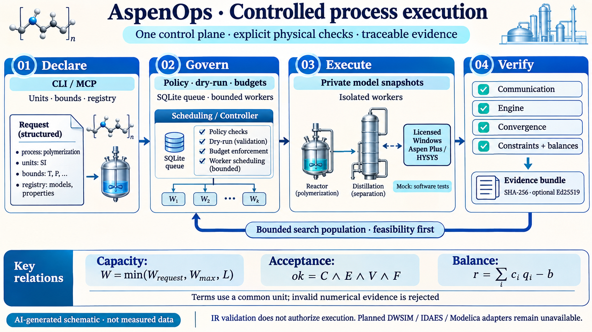
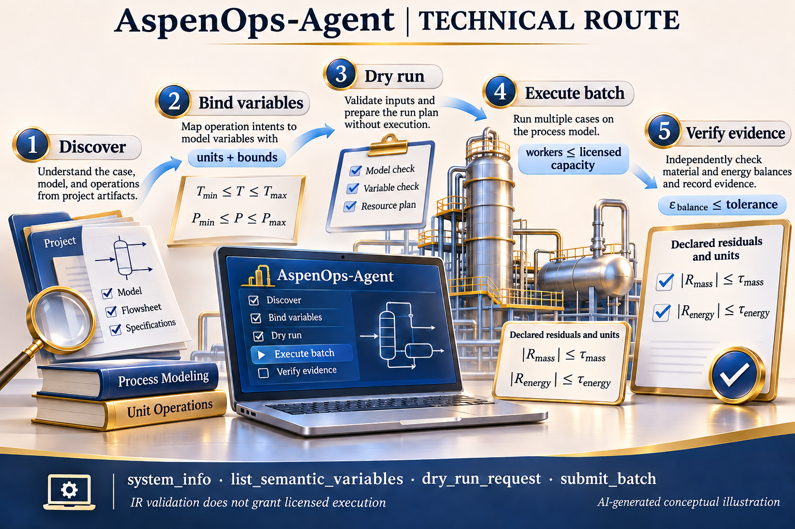
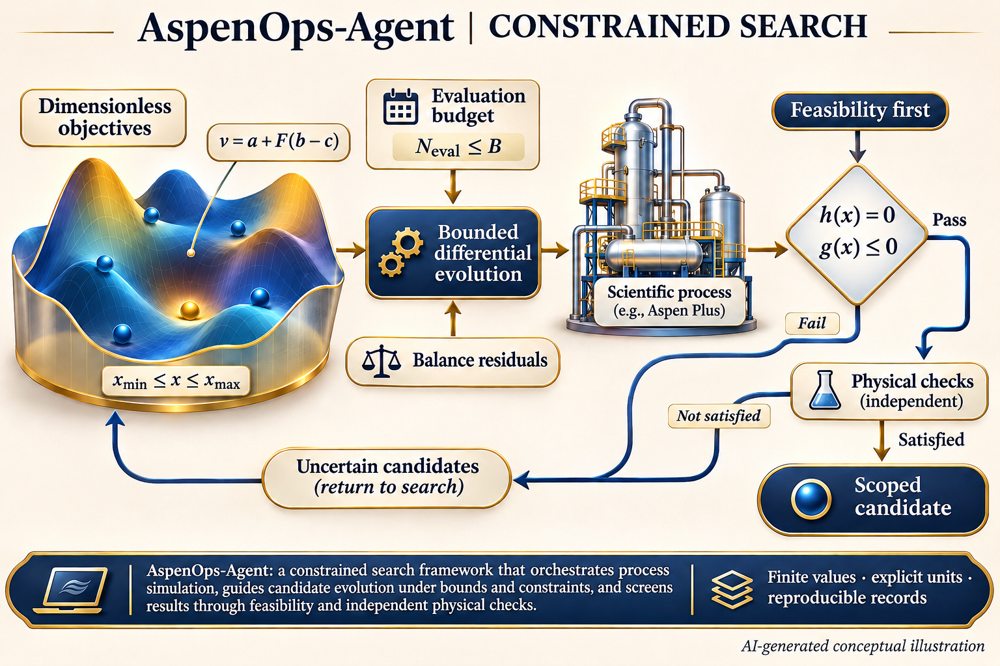
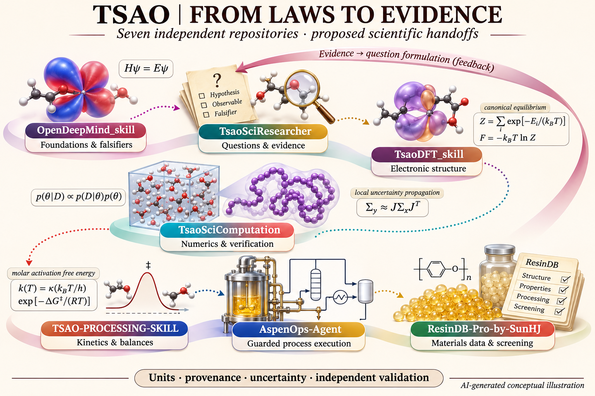

# AspenOps 2.0

**把过程方案变成有单位、有边界、可追溯的求解请求，并逐点核验收敛、约束和衡算。**

[English](README.en.md) · [快速开始](#快速开始) · [技术路线](#简洁技术路线) · [数理合同](#数学与工程合同) · [验收](#交付验收) · [完整实现指南](docs/implementation-guide.zh-CN.md)


`aspenops-nexus 2.0.0` 是 Aspen Plus / Aspen HYSYS 的 Python 控制面，适合已有模型的条件扫描、受约束优化、可复现故障诊断和 Agent 工具调用。CLI、MCP 与持久队列共用同一运行时、scheduler 和 PoolManager；商业模拟器及用户审核过的模型负责物性、设备方程和流程求解。

当前可以先在 Linux 或 Windows 运行 Mock，检查请求、队列、数值边界和证据合同。真实 COM 执行需要许可 Windows 环境；工程资格保持 **`PENDING_REAL_ASPEN_CERTIFICATION`**。Mock 回归验证不代表真实 Aspen 已验收，发现 ProgID 也不证明某个商业版本已通过资格验证。

## 执行架构



**图 1｜完整 AI 生成示意图。** 从意图到原始证据的关系图；其中装置、箭头和公式不表示本项目已完成物理模拟。每个 Worker 使用私有模型快照，所有入口复用同一执行拓扑。

| 软件责任 | 实现入口 | 使用时先确认 |
|---|---|---|
| 绑定语义变量、单位与读写权限 | [registry](src/aspenops_nexus/registry.py)、[evaluation_plan](src/aspenops_nexus/evaluation_plan.py) | 具体模型节点已核实，禁止猜测 Tree Path / 对象链 |
| 限定请求、隔离求解与恢复队列 | [policy](src/aspenops_nexus/policy.py)、[pool](src/aspenops_nexus/pool.py)、[scheduler](src/aspenops_nexus/scheduler.py) | 允许路径、声明许可容量与私有模型身份 |
| 采样、搜索与逐点评估 | [design](src/aspenops_nexus/design.py)、[optimizer](src/aspenops_nexus/optimizer.py)、[evaluation](src/aspenops_nexus/evaluation.py) | 输入范围、目标尺度、必要输出和工程容差 |
| 固定结果身份并核验证据 | [provenance](src/aspenops_nexus/provenance.py)、[archive_safety](src/aspenops_nexus/archive_safety.py) | 原始结果完整，签名使用外部可信公钥 |

过程方案先形成 `aspenops.flowsheet/v1` IR；有效 IR 仅证明声明合同通过。DWSIM、IDAES、Modelica/FMI 执行适配器和通用 IR 编译器仍为 **`planned` / 未实现**。现有 v2 原生构建协议要求对应适配器资格与一致性证据，不能由规划对象推导出生产可用性。[IR 边界](docs/process-intent-ir.md) · [原生适配器门](docs/native-adapter-conformance.md)

## 快速开始

从仓库根目录执行；建议使用与 CI 相同的 **uv 0.11.16** 和 Python 3.12。

```bash
git clone https://github.com/SUNHAOJUN22/AspenOps-Agent.git
cd AspenOps-Agent
uv lock --check
uv sync --frozen --extra dev --extra agent --extra signing
uv run aspenops --version
uv run aspenops doctor --probe
uv run aspenops demo
uv run aspenops dry-run examples/guarded-mock-batch.example.json
uv run aspenops run-batch examples/guarded-mock-batch.example.json \
  --output var/guarded-results.json --bundle var/guarded-run-bundle.zip
uv run aspenops verify-bundle var/guarded-run-bundle.zip
```

[这个请求](examples/guarded-mock-batch.example.json)运行三个温度／回流比点，声明必要输出、产品纯度和进料读回检查。`declared_feed_setpoint` 只核对 `120 kg/h` 的设定值一致性；Mock 没有全部出口，不能据此证明装置质量守恒。[可执行示例回归](tests/test_readme_guarded_example.py)

`dry-run` 不启动 Aspen，返回路径、注册表摘要、有效 Worker 数和 I/O 预算。`run-batch` 保存逐点 JSON 与证据 ZIP；任一点 `ok=false` 时退出码为 `2`，失败诊断仍保留。`verify-bundle` 检查归档和摘要，未签名包只提供完整性证据。[CLI 合同](src/aspenops_nexus/cli.py)

Windows 同步依赖时另加 `--extra windows`；再按 [Windows 部署指南](docs/windows-setup.md)配置真实后端。`.env.example` 是模板，变量需导入实际进程环境。

## 简洁技术路线



**图 2｜完整 AI 生成示意图。** 公式表达软件接受条件与资源约束。实际 Agent 必须按以下顺序执行：

1. 调用 `system_info`，记录 backend 与 ProgID。
2. 对具体 case / registry 调用 `list_semantic_variables`，核实输入输出、单位、上下界及权限。
3. 每种新批次定义先调用 `dry_run_request`，声明必要输出、领域约束及可获得的完整衡算项。
4. 超过 16 点或长求解使用 `submit_batch`；用 `job_status` / `job_result` 追踪任务。`run_batch_sync` 最多 16 点。
5. 只接受逐点 `ok=true`；通信、引擎、收敛、数值有效性、约束和衡算分别检查。任务 `completed` 本身不是接受证据。
6. 保存原始结果并调用 `verify_evidence_bundle` 后再报告结论；工程解释和许可认证另行审阅。

$$
W_{\rm eff}=\min(W_{\rm request},W_{\max},L_{\rm declared}),\qquad
\mathrm{ok}=C_{\rm comm}\land C_{\rm engine}\land C_{\rm conv}\land C_{\rm finite}\land C_{\rm constraint}\land C_{\rm balance}.
$$

$W$ 和 $L$ 是非负的容量计数；$L_{\rm declared}$ 来自管理员配置，程序不自动测量许可数量。各 $C$ 为布尔接受门，其中有限性包含 JSON 安全诊断。只有声明的约束和衡算会被检查；通过这些门不能证明遗漏的物理条件。[并发实现](src/aspenops_nexus/pool.py) · [点接受实现](src/aspenops_nexus/evaluation.py)

## 数学与工程合同



**图 3｜完整 AI 生成示意图。** 优化器产生待核验候选；搜索完成并不授予工程可行性。下列实现公式用于解释代码，精确公式、单位与误差含义以本节文本为准。

### 数值入口和单位

请求拒绝重复 JSON 键、非有限数值和解析时下溢成零的非零小数。优化器另拒绝布尔值、数值字符串、溢出及非零 Decimal/Fraction 下溢；调用方已经舍入成零的浮点值无法反推原数。[请求解析](src/aspenops_nexus/json_input.py) · [优化边界回归](tests/test_optimizer_numeric_inputs.py)

$$
y=\frac{a_sx+b_s-b_t}{a_t}.
$$

$x,y$ 分别为源、目标单位的数值，$a$ 为到共同基准的比例、$b$ 为偏移；它们只在 registry 支持的同一量纲间转换。绝对 $20\,{}^\circ\mathrm C$ 转为 $293.15\,\mathrm K$；$10\,{}^\circ\mathrm C$ 的温差尺度为 $10\,\mathrm K$，目标尺度不能加绝对温度偏移。[units.py](src/aspenops_nexus/units.py)

### 衡算残差和容差

各读回量 $q_i$ 先转换到共同 `base_unit`；$c_i$ 是有限无量纲系数，$b$ 是声明目标，$f$ 是尺度下限：

$$
r=\operatorname{fsum}(c_1q_1,\ldots,c_nq_n,-b),\quad
S=\max\left(\sum_i|c_iq_i|,f\right),\quad \rho=|r|/S,
$$

$$
\mathrm{passed}=\mathrm{valid}\land\left(|r|\le a_{\rm tol}\ \lor\ \rho\le r_{\rm tol}\right).
$$

$r,S,f,a_{\rm tol}$ 具有同一单位；$\rho,r_{\rm tol}$ 无量纲，$S$ 必须为正且不含 $|b|$。`valid` 先检查有限性、定义域和下溢；非零乘积下溢失败，非零比值下溢使用保守正上界并标注 `relative_upper_bound`。`constraint_non_finite` / `balance_non_finite` 表示无效证据，`constraint_failed` / `balance_failed` 表示声明检查不通过。其他标量约束保留自己的运算符与容差。[evaluation.py](src/aspenops_nexus/evaluation.py)

### 无量纲目标和有限搜索预算

$$
z_j=\sigma_j\frac{y_j-r_j}{s_j},\quad J=\sum_jw_jz_j,\quad s_j>0,\ w_j>0.
$$

$y_j,r_j,s_j$ 分别是目标值、参考值和同单位的正尺度；$\sigma_j=+1$ 为最小化、$-1$ 为最大化。$z_j,J,w_j$ 无量纲。可行解优于不可行解；可行解比较目标，不可行解比较诊断违约量，后者不是统一物理单位的工程损失。

DE/rand/1/bin 在声明边界内采用 $v_d=a_d+F_m(b_d-c_d)$，其中 $a_d,b_d,c_d$ 与变量 $x_d\in[\ell_d,h_d]$ 同单位，$F_m$ 无量纲。正常、未取消的执行中，种群 $P\ge4$、预算 $B\ge P$、请求代数 $G\ge0$ 给出

$$
G_*=\min\left(G,\left\lfloor\frac{B-P}{P}\right\rfloor\right),\qquad
N_{\rm eval}=P(1+G_*)\le B.
$$

不足完整一代的剩余预算不启动下一代；$P,B,G,N_{\rm eval}$ 是整数计数。缓存可能减少实际求解次数，所以候选评估数不能当作真实引擎运行数。算法不保证全局最优，DE 种群也不是热力学系综。[optimizer.py](src/aspenops_nexus/optimizer.py) · [优化指南](docs/optimization-engine.md)

## 统计力学背景与七仓总路线



**图 4｜完整 AI 生成示意图。** 七仓保持独立；虚线是建议接口，不是已实现的端到端运行链。图中统计力学、反应速率与不确定性公式用于解释科学背景；AspenOps 没有配分函数、速率常数或协方差传播求解器。

固定 $N,V,T$ 且 $T>0$ 的正则平衡体系，可用微观态能量 $E_i$ 定义

$$
\beta=(k_BT)^{-1},\quad Z=\sum_i e^{-\beta E_i},\quad
p_i=Z^{-1}e^{-\beta E_i},\quad
F=-k_BT\ln Z=U-TS,\quad S=-k_B\sum_i p_i\ln p_i.
$$

$k_B$ 为 Boltzmann 常数，$E_i,U,F$ 为焦耳，$T$ 为开尔文，$S$ 为焦耳每开尔文，$p_i,Z$ 无量纲，$U=\sum_i p_iE_i$。这里的能量属于微观体系，不是摩尔能量；摩尔形式应使用 $R$。熵是物理统计量，不能当作 Agent 信心或候选搜索评分。[Tong：正则系综与自由能](https://www.damtp.cam.ac.uk/user/tong/statphys/statmechhtml/S1.html)

对开放反应单元，物种积累的一般关系是

$$
\frac{dn_i}{dt}=\dot n_{i,\rm in}-\dot n_{i,\rm out}+V\sum_a\nu_{ia}r_a.
$$

$n_i$ 为物种摩尔数，$\dot n_i$ 为摩尔每秒，$V$ 为立方米，$r_a$ 为单元内均匀或体积平均的反应进度速率，单位为摩尔每立方米每秒，$\nu_{ia}$ 为无量纲计量数。稳态令左端为零，但反应体系的总摩尔流量不必守恒。这是模型审核背景；软件只能检查请求中声明且可观测的线性项，实际质量与能量守恒仍需完整流股和传递项。

四幅图的[提示词与字节来源](docs/assets/ai-generated/README.md)可以核对。二十三幅旧工程 SVG 保留在[历史图集](docs/assets/README.md)，[旧中文 hero](docs/assets/readme-vnext/hero.zh-CN.svg)仅作历史普通链接；所有当前说明图均使用上述原生 AI PNG。

## 实际工作流与配置

### 配置与路径安全

| 配置 | 默认值 | 操作含义 |
|---|---|---|
| `ASPENOPS_BACKEND` / `ASPENOPS_MODE` | `mock` / `default` | 真实后端为 `aspen_plus`、`hysys`；`readonly` 禁止写入 |
| `ASPENOPS_ALLOWED_ROOTS` / `ASPENOPS_STATE_DIR` | 空 / `var` | 真实后端必须声明允许的绝对根目录及范围内的绝对状态目录 |
| `ASPENOPS_LICENSE_SLOTS` / `ASPENOPS_MAX_WORKERS` | `1` / 许可槽数 | 管理员声明并发上限，需另核实真实授权与容量 |
| `ASPENOPS_TIMEOUT_S` / `ASPENOPS_STARTUP_TIMEOUT_S` | `1200` / `90` 秒 | 单点响应预算与 Worker 启动预算 |
| `ASPENOPS_WORKER_MAX_POINTS` / `ASPENOPS_WORKER_MAX_AGE_S` | `200` / `14400` 秒 | 周期回收的点数／年龄上限 |
| 请求／批次／语义操作／优化评估上限 | `10000000` 字节／`10000` 点／`1000000` 次／`10000` 次 | 分别由 `MAX_REQUEST_BYTES`、`MAX_BATCH_POINTS`、`MAX_SEMANTIC_OPERATIONS`、`MAX_OPTIMIZATION_EVALUATIONS` 控制，均加 `ASPENOPS_` 前缀 |

完整类型和上限见 [Settings](src/aspenops_nexus/config.py)。路径展开、规范化后再检查允许范围；主模型只生成私有快照，禁止覆盖。提交时固定绝对模型／registry／checkpoint 路径，并记录 `paths_pinned` 和 `submission_cwd`；摘要继续约束内容身份。禁止旁路 `win32com`、任意 Shell/VBA、未注册的对象路径或第二套 scheduler/PoolManager。[路径合同](src/aspenops_nexus/durable_request.py)

### 队列、MCP 和优化

终端 A 保持 scheduler 运行；终端 B 使用同一 `ASPENOPS_STATE_DIR` 提交一次：

```bash
# 终端 A；Ctrl+C 停止
uv run aspenops scheduler
```

```bash
# 终端 B；Bash
JOB_ID=$(uv run aspenops submit examples/guarded-mock-batch.example.json \
  | python -c "import json,sys; print(json.load(sys.stdin)['job_id'])")
uv run aspenops job "$JOB_ID"
# 仅在确需取消时执行
uv run aspenops cancel "$JOB_ID" --grace-s 2
```

PowerShell 使用 `ConvertFrom-Json` 后读取 `.job_id`。任务经过租约、心跳和 fencing 保护；可恢复失败进入 `retry_wait`，耗尽尝试进入 `dead_letter`。提交成功不表示已有服务执行。[Agent 使用指南](docs/agent-usage.md)

```bash
uv run aspenops mcp
uv run aspenops optimize examples/optimization-request.example.json \
  --output var/optimization-result.json
```

MCP 为本地 stdio，安装 `agent` extra 后使用 `mcp>=1.30.0,<2`；服务 lifespan 管理同一 scheduler/PoolManager。优化工具为 `submit_optimization`、`optimization_status`、`optimization_result`、`cancel_optimization`。输出保留 trace、候选、可行 Pareto 集与预算；checkpoint 是原子复查快照，不宣称任意点自动恢复 DE 状态。[MCP 实现](src/aspenops_nexus/mcp_server.py)

[历史 MCP 生命周期图](docs/assets/readme/mcp-runtime-lifecycle.svg)保留用于实现追溯；当前 AI 示意图见上文。

### 过程意图检查

```bash
uv run python scripts/validate_process_ir.py examples/process-intent.example.json \
  --canonical-output var/ci/process-intent-canonical.json \
  --report-output var/ci/process-intent-report.json
uv run python scripts/render_process_ir_dashboard.py \
  --input var/ci/process-intent-report.json \
  --output-html var/ci/process-ir-dashboard.html \
  --output-svg var/ci/process-ir-dashboard.svg
uv run python scripts/validate_process_design_v2.py \
  examples/process-requirement-v1.example.json examples/process-design-v2.example.json \
  --report-output var/ci/process-design-report.json
```

v1 检查组件、设备、端口、流股、引用及资源上限，规范排序固定图身份。v2 另检查需求绑定、参数、组成、电荷、质量与 recycle 合同。`process-ir-dashboard.html` 展示合同检查；它不是外部模拟结果。原生构建须通过 manifest、schema、单位、事务、失败隔离、拓扑读回、签名资格和撤销检查，缺失证据时阻断。[受控构建](src/aspenops_nexus/native_builder.py)

### 缓存和实时状态

`reinitialize` 独立点支持持久缓存、`same_batch_dedup`、`inflight_singleflight`；SQLite WAL 与内存 LRU 减少重复读取，返回值深复制隔离。默认不缓存失败；启用 `ASPENOPS_CACHE_FAILURES` 仍拒绝通信／引擎失败和污染 Worker 结果。规范 JSON 使用 `allow_nan=False`。[缓存实现](src/aspenops_nexus/cache.py)

**缓存命中只返回独立历史结果**，不向当前 Worker 写回状态。`warm_start` 禁用缓存，要求单 Worker、同一 session、严格递增且唯一的 step，不能与冷点混用。跨调用／租约仍检查绑定；已派发步骤即使不收敛也消耗编号，派发前取消不消耗编号。`warm_start_session_mismatch`、`warm_start_step_not_increasing` 在读写前拒绝且保留原轨迹；session 标签不是用户身份认证。

关闭、替换、超时或失败冷初始化会使续算失效。`warm_start_state_lost` 后，只有当前 Worker **实际**完成通信／引擎成功且收敛的 `reinitialize` 才清除旧绑定；缓存冷结果不能恢复状态，约束接受仍单独判断。[热启动合同](tests/test_warm_start_session_binding.py)

## 原生失败隔离

Worker 绑定协议版本、请求 ID 和结果 schema；真实后端用 Windows Job Object 监督。终止前核实 PID、创建时间、可执行文件指纹及后代关系，不终止用户独立运行的 Aspen。新句柄在身份核验前纳入清理责任，启动或替换中断仍清理已取得的 Worker。[所有权回归](tests/test_pool_startup_ownership.py) · [进程监督](src/aspenops_nexus/windows_job.py)

`timeout_s` 是单次 Worker 响应预算，不包含排队、启动、重建和证据打包的总耗时。超时返回 `worker_timeout` 并回收所属 Worker；周期点数／年龄、崩溃、协议错配和污染状态也有独立回收路径。替换增加 generation，不自动恢复旧实时状态。[Worker 实现](src/aspenops_nexus/worker.py)

## 优化建议与使用边界

先提升结果可信度，再增加吞吐量。以下建议对应已有控制点和仍待收集的证据：

| 优先级 | 可执行改进 | 验证依据 |
|---|---|---|
| 1. 模型与物理边界 | 补全真实 registry、Golden Cases、物料／能量项及工程容差 | 许可 Windows 运行、原始点结果、工程师接受 |
| 2. 有效搜索域 | 先小规模冷点确认可行区，固定参考值和单位尺度，再扩大 LHS／DE | 可行比例、失败类别、预算及候选 trace |
| 3. 减少重复工作 | 对独立冷点启用缓存／去重；减少未使用输出和 registry 读取 | 摘要一致性、操作计数与数值等价 |
| 4. 按证据提高并发 | 从单 Worker 开始，按真实许可、内存和稳定性逐步扩容 | 同环境测量、完整失败记录；不以 Mock 时间宣称 Aspen 加速 |
| 5. 扩展求解器 | 为每个计划适配器实现并执行 conformance 合同 | manifest、单位、事务、失效隔离和目标版本见证 |

```bash
uv run aspenops benchmark --points 4 --workers 1,2
uv run python scripts/measure_cli_startup.py --output var/ci/cli-startup.json
uv run python scripts/measure_operation_counts.py --output var/ci/operation-counts.json
uv run python scripts/measure_job_store_queries.py --output var/ci/job-store-query-plan.json
```

`cli-startup.json`、`operation-counts.json`、`job-store-query-plan.json` 应与同环境、同负载的重复测量一起解释。[Performance Audit V2](docs/performance-audit-2026-07-27-v2.md)是历史对照；没有新测量时不声明性能改善。装置安全、物性模型适用性和工厂级认证不由本代码授予。

## 交付验收

项目只维护长期分支 `main`。[质量报告](docs/quality-report.md)中的**已验证归档基线**供对照，**不是对任意后续提交的自动声明**。当前交付必须绑定目标 SHA、完整日志、JUnit、覆盖率、构建和工件摘要；收集数、跳过数、旧截图与重复顺序运行不能相加作为唯一通过数。

```bash
uv lock --check
uv sync --frozen --extra dev --extra agent --extra signing
uv run ruff check .
uv run ruff format --check .
uv run mypy src
uv run python -m compileall -q src scripts
uv run python scripts/audit_source_tree.py
uv run pytest -W error::ResourceWarning \
  --cov=aspenops_nexus --cov-branch --cov-fail-under=95.0
uv build
uv run python scripts/check_mcp.py
uv run python scripts/check_wheel_metadata.py --dist-dir dist
uv run python scripts/validate_process_ir.py examples/process-intent.example.json
uv run aspenops --version
uv run aspenops demo
uv run python scripts/verify_delivery.py --root . --output var/ci/delivery-acceptance.json
```

CI 审计 Linux 与 Windows、Python 3.11、3.12、3.13 六种冻结依赖组合，另执行 Bandit `1.9.4` high/high 和 Python 3.12 逆序／固定随机顺序测试。`ci.yml` 使用 `ubuntu-24.04`，`windows-control-plane.yml` 使用 `windows-2025`；另有 `generate-performance-evidence.yml` 和 `licensed-aspen-certification.yml`，具体执行矩阵以工作流为准。

手动工作流在 `actions/checkout` 前检查 `refs/heads/main`，非 main 显式失败并返回 status 2；候选／基线使用 `detached` worktree。许可作业在受保护、自托管 Windows 上串行执行，要求 `expected_head_sha == GITHUB_SHA`，记录 `GITHUB_RUN_ID`、`GITHUB_RUN_ATTEMPT`、`LICENSED_EVIDENCE_DIR`、`run-metadata.txt` 和 `job_status`。证据位于 `RUNNER_TEMP` / `${{ runner.temp }}`，工件名含 `github.run_id` / `github.run_attempt`；许可上传使用 `aspenops-licensed-artifact` 和 `if-no-files-found: error`。[许可控制面](docs/licensed-certification-control-plane.md)

软件、Windows 控制面和许可证据面板应分别读取；真实引擎 Golden Cases、签名证据与工程师接受缺一不可。长时稳定性需记录实际活动时间和循环结果；一次回归不证明六小时完成。[验收清单](README_ACCEPTANCE.md) · [完整交付流程](docs/delivery-acceptance.md)

[面板生成器](scripts/render_test_dashboard.py)读取本次运行的 JUnit 与覆盖率工件，分别输出 `test-dashboard-quality.html`、`test-dashboard-windows.html` 和 `test-dashboard-licensed.html`。面板只汇总所提供证据；缺失、跳过或失败的检查保留其状态。

## 确定性交付包

运行包绑定请求、结果、模型／registry 和环境摘要；读取时拒绝危险路径、重复声明、超限成员与摘要错配。SHA-256 证明指定字节身份，Ed25519 还需要外部可信公钥；包内自带公钥不能自行成为信任根。[证据实现](src/aspenops_nexus/provenance.py)

`scripts/build_delivery_bundle.py` 要求干净 Git tree 和真实当前 SHA，生成排序成员、规范时间戳的 `aspenops-source-<sha12>.zip`、`aspenops-handover-<sha12>.zip`、`aspenops-sbom-<sha12>.spdx.json`（`SPDX-2.3`）及 `SHA256SUMS`：

```bash
# 在已提交、已验证的干净 main 上执行
uv run python scripts/build_delivery_bundle.py \
  --root . --output-dir var/delivery --source-sha "$(git rev-parse HEAD)"
uv run python scripts/verify_delivery.py \
  --root . --require-current-qualification \
  --output var/ci/delivery-acceptance-current.json
```

`--require-current-qualification` 需要当前来源的合格证据记录；仅生成 ZIP 不授予 PASS。完整性、来源真实性和工程适用性分别判断。[交付包格式](docs/delivery-bundle.md)

## 开发与故障定位

实现位于 `src/aspenops_nexus/`，请求在 `examples/`，行为回归在 `tests/`，审计／打包／测量在 `scripts/`；[CONTRIBUTING](CONTRIBUTING.md)列出完整开发门禁。

| 现象 | 首先检查 |
|---|---|
| 预检失败 | 允许路径、registry 权限、单位、边界、预算和必要输出 |
| `worker_timeout` | 响应预算、求解状态和回收证据；终止不意味着收敛 |
| 热启动失败 | 活跃 session、最后已派发 step、当前 Worker 是否实际冷初始化 |
| `balance_underflow` 或有限性失败 | 原始数值、量级、缺失项和派生溢出；不能把非零量改成零 |
| 长期 pending | scheduler 是否运行、两端是否共享状态目录 |
| 证据／许可失败 | 目标 SHA、信任根、有效期、撤销状态及原始阻断日志 |

[Apache-2.0](LICENSE) 覆盖本仓库代码；Aspen Plus、Aspen HYSYS、Windows、客户模型和商业工艺数据遵循各自许可与使用要求。

<!-- CURRENT_MAIN_ACCEPTANCE_V2:START -->
## 可再生实现索引

本索引由 `scripts/refresh_current_main_readme.py --write` 生成，使用 `--check` 检查固定点。正文中的数理定义与可执行流程是主要使用说明；下列源文件与历史概念图保留用于追溯。

[`src/aspenops_nexus/process_ir.py`](src/aspenops_nexus/process_ir.py) · [`src/aspenops_nexus/models.py`](src/aspenops_nexus/models.py) · [`src/aspenops_nexus/pool.py`](src/aspenops_nexus/pool.py)

[历史中文代码合同图](docs/current-main/aspenops-current-main-zh.svg)

软件门禁不等于真实 Aspen Plus/HYSYS 工程认证；外部状态保持 PENDING_REAL_ASPEN_CERTIFICATION。

<!-- CURRENT_MAIN_ACCEPTANCE_V2:END -->
