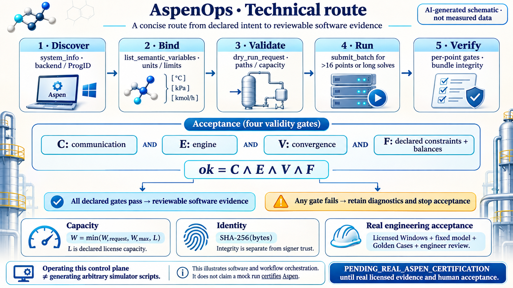

# AspenOps 2.0 — Final Acceptance README / 最终验收说明

> **Status scope / 状态边界：** 本页规定软件、文档和证据的核验方式，不自动认证当前提交，也不声称商业模拟器、实验或工业装置已经执行。This page defines software and evidence checks; it is not an automatic attestation for the current commit or an external run. Boundary marker: `PENDING_REAL_ASPEN_CERTIFICATION`.



当前图是完整 AI 生成的 PNG 示意图。原[确定性验收 SVG](docs/assets/acceptance/final-acceptance-map.svg)保留为历史普通链接，继续接受原完整性检查。图像均不提供测量或外部执行证据。

## 中文：交付定位

支持的发布资格平台为 **Windows 与 Linux**。Linux 检查可移植控制面、验证和打包路径；真实 Aspen Plus/HYSYS COM 执行依赖许可 Windows 环境。macOS 不属于发布资格矩阵。使用说明见[中文首页](README.md)与[完整实现指南](docs/implementation-guide.zh-CN.md)。

### 1. 明确执行和验收顺序

| 阶段 | 实际职责 | 不能代替的证据 |
|---|---|---|
| INTENT / 意图 | 有类型的请求与 Process IR、引用假设 | 实际模型和授权 |
| RULES / 规则 | 单位、边界、拓扑和声明的工程检查 | 物性模型的适用性 |
| SCHEDULER / 调度 | 路径、预算、隔离 Worker、许可配置 | 真实许可数量及容量测量 |
| SIMULATOR / 求解 | 已有模型的受控调用 | 收敛与物理可行性 |
| EVIDENCE / 证据 | 原始结果、摘要、签名与来源身份 | 工程师接受和工业验证 |

### 2. 按实际合同判断数值结果

完整点接受是通信、引擎、收敛与可行性的合取；其中可行性还包含有限输出、JSON 安全诊断和声明的约束／衡算：

\[
OK=C_{comm}\land C_{engine}\land C_{conv}\land C_{finite}\land C_{constraint}\land C_{balance}.
\]

线性衡算将每项转换到共同单位，再计算

\[
r=\operatorname{fsum}(c_1q_1,\ldots,c_nq_n,-b),\quad
S=\max\left(\sum_i|c_iq_i|,f\right),\quad \rho=|r|/S.
\]

只有各项和派生量有效时，才检查实际的绝对**或**相对门：

\[
C_{balance}=C_{valid}\land\left(|r|\le a_{tol}\ \lor\ \rho\le r_{tol}\right).
\]

$S$ 不含目标 $|b|$，且必须为正；$r,S,f,a_{tol}$ 具有共同单位，$\rho,r_{tol}$ 无量纲。非零乘积下溢为无效证据；非零比值下溢的保守上界在诊断中单独标注。这里没有把一般的 $a+r|x|$ 形式写成所有检查的统一实现。不同标量比较仍服从其声明运算符和容差。

真实物料与能量衡算还需要完整的流股、反应和传递项。示例的 feed-setpoint 一致性检查不等于完整装置质量守恒。

### 3. 并发、状态与身份

代码使用声明容量的实际最小值：

\[
W_{effective}=\min(W_{request},W_{max},L_{declared}).
\]

许可证、内存和稳定性需要部署时另行核实；上式不自动发现这些资源。每个 Worker 使用私有模型快照与隔离会话。`warm_start` 必须单 Worker、同一 session、严格递增 step；缓存命中只返回独立历史结果，不恢复当前求解器状态。

独立冷态请求可使用缓存；默认不缓存失败。显式 `ASPENOPS_CACHE_FAILURES` 仍拒绝通信／引擎失败与污染 Worker 结果。状态丢失后，只有当前 Worker 实际完成且通信、引擎和收敛成功的 `reinitialize` 才恢复续算资格，约束接受仍单独判定。

SHA-256 固定声明字节，规范 JSON 使用 `allow_nan=False`。它不认证测量真伪或签名者权限；Ed25519 需要外部可信公钥。发布证据必须绑定真实 commit、锁文件、环境与产物摘要，不能用未提交 tree 冒充已验收 commit。

### 4. 执行检查

```bash
python scripts/final_acceptance_preflight.py --root . --json
uv lock --check
uv sync --frozen --extra dev --extra agent --extra signing
uv run ruff check .
uv run ruff format --check .
uv run mypy src
uv run python -m compileall -q src scripts
uv run python scripts/audit_source_tree.py
uv run pytest -W error::ResourceWarning --cov=aspenops_nexus --cov-branch --cov-fail-under=95.0
uv build
```

预检的 PASS 只表示其检查的交付表面完整，不替代原完整 CI、顺序测试、依赖审计、Windows 资格、当前来源证明或许可运行。性能比较须先验证数值等价，再保留同环境、同负载和重复测量记录；没有测量时不声明加速。完整命令和守卫见[交付文档](docs/delivery-acceptance.md)。

## English: delivery contract

The release-qualification platform matrix is **Windows and Linux**. Linux covers portable control-plane, validation and packaging paths; licensed Aspen Plus/HYSYS COM execution requires Windows. macOS is outside this matrix. See the [English home](README.en.md) and [implementation guide](docs/implementation-guide.en.md).

Acceptance is conjunctive: communication, engine, convergence, valid numerical evidence, declared constraints and declared balances all matter. Linear balances use the finite-value/underflow checks followed by the absolute **OR** relative condition above. The scale excludes the target magnitude; its residual, floor and absolute tolerance share one physical unit. Scalar comparisons retain their own operators and declared tolerances.

The effective capacity is the minimum of requested workers, configured maximum and declared license slots. Memory, stability and actual entitlement need separate deployment evidence. Warm starts require one live worker and an ordered session. A cache hit is an independent historical result, not restoration of simulator state. Default failure caching is off; opting in does not admit communication/engine failures or tainted results.

Run the original frozen quality gates after the fast preflight. The preflight reports software/documentation checks, not current-commit release qualification. Benchmark claims need numerical equivalence and repeatable same-environment measurements. Digests establish declared byte identity; authenticity also requires externally trusted keys. Real engineering acceptance remains `PENDING_REAL_ASPEN_CERTIFICATION` until licensed evidence and human review exist.

### Machine-readable scope

The preflight retains schema `tsao.final-acceptance-preflight/v1`, SHA-256 identities and explicit non-execution fields:

```json
{
  "solver_or_experiment_executed": false,
  "automatic_scientific_approval": false,
  "delivery_platforms": ["windows", "linux"]
}
```

## AI-image declaration / AI 图像声明

The active `docs/assets/ai-generated/roadmap.png` is an unmodified full imagegen raster with an exact prompt and hash record. The earlier SVG is a historical deterministic drawing, not a newly generated AI raster. Neither is measured data, solver output or evidence that external execution occurred. [Current figure provenance](docs/assets/ai-generated/README.md).
